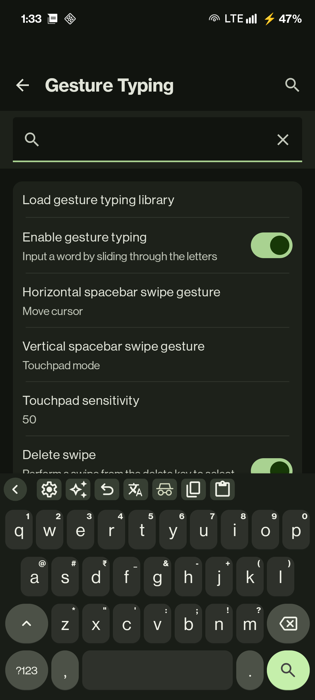
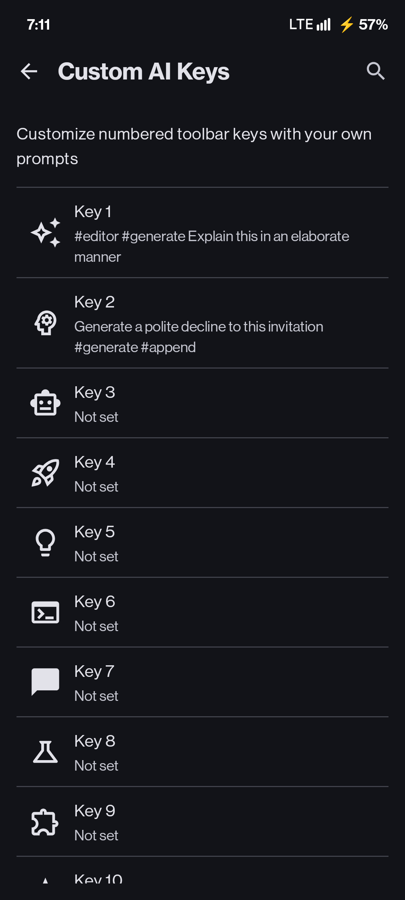

# LeanType

<picture>
  <source media="(prefers-color-scheme: dark)" srcset="docs/images/leantype_banner_dark.svg">
  <source media="(prefers-color-scheme: light)" srcset="docs/images/leantype_banner_light.svg">
  
</picture>

**A private, smart and deeply customizable open-source Android keyboard.** 
Built on [HeliBoard](https://github.com/Helium314/HeliBoard). No tracking, and a flavor with no internet permission at all.

[Download](#download) • [Features](#features) • [Plugins](#plugins) • [Full feature guide](docs/FEATURES.md) • [Support](#support)

<table>
  <tr>
    <td></td>
    <td></td>
    <td></td>
    <td></td>
    <td></td>
  </tr>
</table>

## Why LeanType

- **Private by design**: no tracking. The Offline flavor has no internet permission, so nothing can leave your device.
- **AI writing tools**: proofread, rewrite and translate with Gemini, Groq, OpenAI, your own server (Ollama, LM Studio), or a model running on your phone.
- **Voice, handwriting and camera text**: on-device Whisper voice typing, handwriting recognition and OCR from the camera or screenshots, all offline.
- **Fast typing**: gesture typing, clipboard history, a text expander, inline math (`25*4=`) and full physical keyboard support.
- **Make it yours**: themes, wallpaper blur, 12+ key sound packs, hexagonal layouts, a floating keyboard and per-app profiles.
- **Many languages**: downloadable dictionaries for many languages, plus Chinese, Japanese and Korean input through the CJK plugin.

## Download

<table border="0">
  <tr>
    <td align="center"></td>
    <td align="center"></td>
    <td align="center"></td>
    <td align="center"></td>
  </tr>
</table>

**Which APK?**

| APK | Pick it if you want | Internet |
| :--- | :--- | :--- |
| `standard-release` (recommended) | Cloud AI, in-app plugin downloads and update checks | Optional |
| `offline-release` | No network at all; on-device AI through the Offline AI plugin | None (no permission) |
| `standard-lite-release` / `offline-lite-release` | The same, about 4 MB smaller: English only, other app languages as [language packs](https://github.com/LeanBitLab/LeanType-Language-Packs) (packs need Android 11+) | Same as above |

All builds, Lite included, run on Android 6.0+.

## Features

| Area | Highlights |
| :--- | :--- |
| **AI** | Proofreading and rewriting with cloud, self-hosted or on-device GGUF models; 10 custom AI keys with your own prompts; models fetched from your provider |
| **Translation** | Translate in the keyboard with the offline plugin, built-in ML Kit or your AI provider |
| **Voice & handwriting** | On-device Whisper voice typing with a live waveform; handwriting canvas with offline models |
| **Camera & screenshots** | Scan text with an in-keyboard camera; a pill offers 1-tap text from new screenshots, with cleanup options |
| **Typing** | Gesture typing, full-keyboard and backspace swipe gestures, touchpad mode, text editing panel, inline math, smart learning |
| **Clipboard & shortcuts** | Searchable clipboard history with pinning and OTP filtering; text expander with `%date%`, `%clipboard%` and more; emoji search; GIF and sticker search |
| **Look & feel** | Themes, live wallpaper blur, key shape and spacing controls, sound packs, hexagonal layouts, floating keyboard (automatic in landscape), split suggestions |
| **Languages** | Downloadable dictionaries, Chinese Pinyin, Japanese Kana and Romaji, Korean Hangul (CJK plugin), Gboard dictionary import |
| **Control** | Per-app profiles (**Settings → Advanced → App Profiles**), selective backup with encrypted API key export, storage and cache cleanup, word blacklist with regex |

Every feature and setting is described in the [full feature guide](docs/FEATURES.md).

## Plugins

Optional features come as separate plugins, so the keyboard stays small.

- **Standard**: open the plugin's screen under **Settings → Plugins** and tap **Download Plugin**.
- **Offline**: download the plugin APK from its releases page and load it on the same screen.

| Plugin | Adds | Settings screen |
| :--- | :--- | :--- |
| [Voice](https://github.com/LeanBitLab/Leantype-Voice-Plugin) | On-device Whisper voice typing ([models](https://github.com/LeanBitLab/leantype-whisper-models)) | **Settings → Plugins → Voice Input** |
| [Translation](https://github.com/LeanBitLab/LeanType-Translation-Plugin) | Offline translation | **Settings → Plugins → Translation** |
| [Handwriting](https://github.com/LeanBitLab/Leantype-Handwriting-Plugin) | Handwriting recognition | **Settings → Plugins → Handwriting Input Plugin** |
| [OCR](https://github.com/LeanBitLab/LeanType-Ocr-Plugin) | Camera and screenshot text | **Settings → Plugins → Text Recognition (OCR)** |
| [Offline AI](https://github.com/LeanBitLab/LeanType-Offline-AI-Plugin) | On-device GGUF models (Offline flavor) | **Settings → Plugins → Offline AI Plugin** |
| [GIF](https://github.com/LeanBitLab/LeanType-Gif-Plugin) | GIF and sticker search (GIPHY, KLIPY) | **Settings → Plugins → GIF Search** |
| [CJK](https://github.com/LeanBitLab/LeanType-CJK-Plugin) | Chinese, Japanese and Korean input | **Settings → Plugins → CJK Input** |

Also available: [sound packs](https://github.com/LeanBitLab/LeanType-SoundPacks), [language packs](https://github.com/LeanBitLab/LeanType-Language-Packs) and [community themes](https://github.com/topics/leantype-theme) (tag your theme repo `leantype-theme`).

<b>Quick setup: AI, dictionaries, gesture typing</b>

- **Cloud or self-hosted AI**: get a key from [Google AI Studio](https://aistudio.google.com/apikey) or [Groq](https://console.groq.com/keys), or run [Ollama](https://ollama.com/) / [LM Studio](https://lmstudio.ai/) on your network. Then open **Settings → AI Integration → AI Provider**, pick a provider (or Custom for an OpenAI-compatible server) and a model.
- **On-device AI** (Offline flavor): load the Offline AI plugin, then pick a GGUF model file (for example `Qwen2.5-0.5B-Instruct-Q4_K_M.gguf`) in **Settings → AI Integration → Offline Model**.
- **Dictionaries**: **Settings → Languages & Layouts → Dictionaries**, or tap the dictionary icon in the toolbar when one is missing.
- **Gesture typing**: Standard downloads the library in **Settings → Gestures & swipes**. Offline: [download the library](https://github.com/erkserkserks/openboard/tree/46fdf2b550035ca69299ce312fa158e7ade36967/app/src/main/jniLibs) and load it on the same screen.

## Community

[Issues](https://github.com/LeanBitLab/LeanType/issues) • [Discussions](https://github.com/LeanBitLab/LeanType/discussions) • [Telegram](https://t.me/leanbitlab) • [More LeanBitLab apps](https://github.com/LeanBitLab#-android-projects)

## Support

LeanType is community-funded. If it saves you time every day, consider backing it on [GitHub Sponsors](https://github.com/sponsors/LeanBitLab) or [Open Collective](https://opencollective.com/leanbitlab-org), or share it with a friend.

## Credits and license

Built on [HeliBoard](https://github.com/Helium314/HeliBoard) by Helium314, [OpenBoard](https://github.com/openboard-team/openboard) and [AOSP LatinIME](https://android.googlesource.com/platform/packages/inputmethods/LatinIME/), with [llama.cpp](https://github.com/ggerganov/llama.cpp), [llamacpp-kotlin](https://github.com/ljcamargo/llamacpp-kotlin) and [whisper.cpp](https://github.com/ggerganov/whisper.cpp). Thanks to all [contributors](https://github.com/LeanBitLab/LeanType/graphs/contributors).

Licensed under [GPL-3.0](LICENSE).
