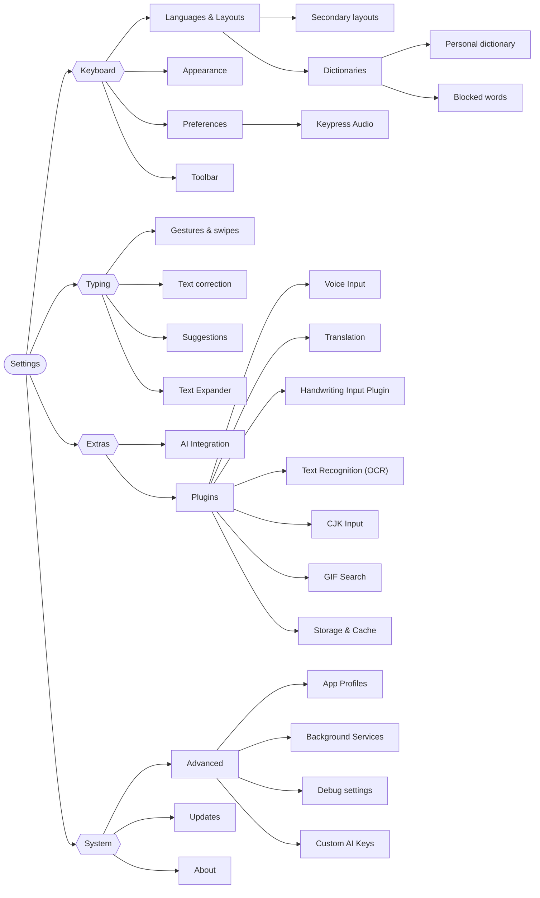

# LeanType Features & Setup Guide

LeanType combines a lightweight, privacy-focused keyboard foundation with cutting-edge productivity tools: **Multi-Provider Cloud & Offline AI**, **On-Device Whisper Voice Typing**, **Handwriting Recognition**, **Dual-Engine In-Keyboard Translation**, **Rich Text Utilities**, and **Deep UI Customization**.

---

## 📑 Index

| Section | Description |
| :--- | :--- |
| 🆕 **[Summary of New Features](#-summary-of-new-features)** | Complete matrix of all features & settings locations |
| 🤖 **[Multi-Provider Cloud AI](#1-multi-provider-cloud-ai)** | Google Gemini, Groq, and OpenAI-compatible inference |
| 🧠 **[Custom AI Keys & Keywords](#2-custom-ai-keys--keywords)** | 10 custom toolbar prompt keys and themed capsules |
| 🛡️ **[Offline Neural Proofreading (GGUF)](#3-offline-neural-proofreading-gguf)** | 100% on-device private LLM execution via `llama.cpp` |
| 🌐 **[Dual-Engine In-Keyboard Translation](#4-multi-mode-in-keyboard-translation)** | Translation Plugin (ML Kit) or AI translation with auto-fallback |
| 🎙️ **[On-Device Whisper Voice Typing](#5-on-device-whisper-voice-typing)** | Fast speech-to-text with quantized English and multilingual Whisper models |
| ✍️ **[Handwriting Input](#6-handwriting-input)** | Draw letters directly on a handwriting canvas (ML Kit) |
| 🧭 **[Dedicated Text Editing Panel](#7-dedicated-text-editing-panel)** | Gboard-style precision DPAD arrow navigation & selection mode |
| 📐 **[Smart Auto-Spanning Toolbar](#8-smart-auto-spanning-toolbar)** | Symmetrical dynamic toolbar key expansion across screen widths |
| 🖱️ **[Touchpad Mode & Gestures](#9-touchpad-mode--gestures)** | Spacebar swipe gesture & full-screen laptop-style touchpad |
| 🪟 **[Native IME Floating & Resizable Keyboard](#10-native-ime-floating--resizable-keyboard)** | Touch-passthrough, bottom dock bar, and zero dead space floating window |
| ⌨️ **[Dual Toolbar & Split Suggestions](#11-dual-toolbar--split-suggestions)** | Split toolbar actions and word suggestions into separate rows |
| 📝 **[Text Expander](#12-versatile-text-expander--modifiers)** | Shortcut expansion with dynamic template placeholders |
| 📋 **[Searchable Clipboard, Editing & Gestures](#13-searchable-clipboard-editing--gestures)** | Real-time search, swipe-to-edit inline, swipe-to-delete undo and pinned folding |
| 📸 **[Screenshot Suggestions & Capture](#14-screenshot-suggestions--capture)** | Recent screenshot suggestion strip and clipboard storage |
| 🔎 **[Emoji Search](#15-emoji-search)** | Search for emojis by keyword with an Emoji Dictionary |
| 🚫 **[Blocked Words & Regex Blacklist](#16-blocked-words--regex-blacklist)** | Filter out offensive or unwanted words using custom regex patterns |
| 📚 **[Adaptive Personal Dictionary Learning](#18-adaptive-personal-dictionary-learning--suggestion-engine-tuning)** | Customizable repeat learning thresholds & session word boosting |
| 👆 **[Gesture / Glide Typing](#19-gesture--glide-typing)** | Smooth swipe typing with a separately loaded gesture library |
| ⌨️ **[Direct Switch Target IME](#20-direct-switch-target-ime)** | Switch directly to a specific target keyboard with keycode `-10076` |
| 🎨 **[Custom Layout Profiles](#21-custom-layout-profiles)** | Up to 5 custom secondary layouts, each with its own keycode |
| 🔄 **[In-App Update Checker & Release Viewer](#22-in-app-update-checker--release-viewer)** | Direct GitHub release checks and 1-tap release viewer (`standard` flavor) |
| 📦 **[Flavor Architecture & Privacy](#23-flavor-architecture--privacy)** | Breakdown of Standard and Offline flavors |
| 📷 **[Offline Camera OCR & Screenshot Extraction](#24-offline-camera-ocr--screenshot-extraction)** | In-keyboard camera viewfinder, automated screenshot extraction pill, and advanced formatting cleaners |
| 🔢 **[Inline Math Calculation Suggestions](#25-inline-math-calculation-suggestions)** | High-precision arithmetic expression evaluator on typing `=` with 1-tap replacement |
| 🎵 **[Custom Sound Packs & Audio Customization](#26-custom-sound-packs--audio-customization)** | Zero-latency key audio engine, downloadable sound packs from an online catalog, and `.zip` imports |
| ⚙️ **[Per-App Profiles & Compatibility Engine](#27-per-app-profiles--compatibility-engine)** | Per-app composing rules, symbol composing for Tasker, auto-incognito, and Enter overrides |
| ⌨️ **[Hardware & Physical Keyboard Support](#28-hardware--physical-keyboard-support)** | External Bluetooth/USB keyboard suggestions, shortcuts (`Alt` + number by default), D-PAD emoji navigation |
| 🎨 **[Advanced Appearance & Key Ergonomics](#29-advanced-appearance--key-ergonomics)** | Independent corner radii (normal, functional, action), key gaps, padding scales, Shift icons |
| ⌨️ **[Comprehensive Keycodes & Actions Reference](#30-comprehensive-keycodes--actions-reference)** | Complete reference table of all functional, navigation, editing, AI, and hardware keycodes |
| 🎬 **[GIF Search & Media Picker](#31-gif-search--media-picker)** | GIPHY, KLIPY, stickers, live preview, and WhatsApp sticker normalization |
| 🈲 **[CJK (Chinese, Japanese & Korean) Plugin Engine](#32-cjk-chinese-japanese--korean-plugin-engine)** | Pinyin Chinese, Japanese Kana/Romaji, Hangul combiner & candidate strip |
| ⬡ **[Hexagonal Honeycomb Layout Engine](#33-hexagonal-honeycomb-layout-engine)** | Typewise-style hexagonal layout with landscape split |
| 👆 **[Full Keyboard & 2D Backspace Swipe Gestures](#34-full-keyboard--2d-backspace-swipe-gestures)** | Full-surface horizontal swipes and 2D diagonal/vertical deletion |
| 🪟 **[Auto Floating Keyboard in Landscape](#35-auto-floating-keyboard-in-landscape)** | Automatic floating mode switch in landscape orientation |
| 💾 **[Storage & Cache Management Screen](#36-storage--cache-management-screen)** | Categorized storage breakdowns and 1-tap cache/dictionary purging |
| 🖼️ **[System Wallpaper & FastBlurEngine](#37-system-wallpaper--fastblurengine)** | Blurred device wallpaper background with blur intensity slider |
| 📋 **[In-Keyboard Action Pill & Multi-Select Clipboard](#38-in-keyboard-action-pill--multi-select-clipboard)** | Compact floating action pill, batch deletion, pinning, and sensitive data filtering |
| 🔐 **[Granular Backup & API Key Export](#39-granular-backup--api-key-export)** | Separated wordlists vs history and optional API key export (unencrypted) |
| ⌫ **[Exact Visual Line Delete Swipe (Android 14+)](#40-exact-visual-line-delete-swipe-android-14)** | Platform-native text bounds info for visual line wrap tracking |
| 📱 **[Foldable & Large Display Ergonomics](#41-foldable--large-display-ergonomics)** | Auto screen profile detection, unfolded height and padding, and split gap |
| ⚙️ **[Settings Progressive Disclosure](#42-settings-progressive-disclosure)** | Expandable fine-tuning sections across settings categories |
| 🈲 **[Chinese Punctuation & CJK Symbols](#43-chinese-punctuation--cjk-symbols)** | Full-width punctuation, dedicated CJK symbols, and preedit sync |
| 🚫 **[Blocked Words Standalone Import & Export](#44-standalone-blocked-words-import--export)** | Standalone word list import/export with duplicate filtering |
| 🇮🇳 **[Tamil V4 Layout Option](#45-tamil-v4-layout-option)** | Modern Tamil V4 layout option dynamically available across Tamil locales |
| 🔤 **[Custom Text Styles](#46-custom-text-styles)** | Add your own Unicode font styles to the Font Style strip by pasting a styled alphabet |
| 🌍 **[Lite Builds & UI Language Packs](#47-lite-builds--ui-language-packs)** | English-only APKs about 4 MB smaller, with app translations as downloadable packs (Android 11+) |
| 🗺️ **[Settings Map](#48-settings-map)** | Every settings screen and the settings on it, generated from the code |
| ✨ **[More Recent Additions](#49-more-recent-additions)** | Khipro Blinder mode, switch back to the main keyboard on reopen, What's New dialog |

---

## 🆕 Summary of New Features

| Feature | Description | Settings Location |
| :--- | :--- | :--- |
| **Multi-Provider Cloud AI** | Proofread, rewrite, and fix grammar via Gemini, Groq, or OpenAI-compatible custom endpoints. | `AI Integration > AI Provider` |
| **Custom AI Keys** | 10 customizable toolbar keys with prompt templates, hashtags (`#editor`, `#proofread`), and tag capsules. | `AI Integration > Custom AI Keys` |
| **Offline Proofreading (GGUF)** | Zero-network, on-device neural proofreading powered by `llama.cpp` through the Offline AI Plugin. | `Plugins > Offline AI Plugin` *(offline flavor)* |
| **Multi-Mode In-Keyboard Translation** | Translate text with the Translation Plugin (offline ML Kit) or Cloud/Local AI with auto-fallback. | `Plugins > Translation` |
| **Whisper Voice Typing** | On-device speech-to-text with quantized multilingual Whisper models and audio visualizer. | `Plugins > Voice Input > Manage & Download Models` |
| **Handwriting Recognition** | Draw characters on a dedicated canvas with in-app model manager (supported across all flavors via plugin). | `Plugins > Handwriting Input Plugin` |
| **Offline Camera & Screenshot OCR** | Live in-keyboard camera scanner and screenshot suggestion pill with rich text cleaners (casing, join styles, dehyphenation). | `Plugins > Text Recognition (OCR)` |
| **Inline Math Calculation** | Instant arithmetic calculation suggestions on typing `=` with 1-tap expression replacement. | `Suggestions > Inline math calculation` |
| **Custom Sound Packs** | Zero-latency key audio engine with downloadable packs from an online catalog, and `.zip` import. | `Preferences > Keypress Audio` |
| **GIF Search & Media Picker** | Search GIFs and stickers via GIPHY/KLIPY with live preview and WhatsApp sticker insertion. | `Plugins > GIF Search` / `Toolbar > Select toolbar keys` |
| **CJK Plugin Engine** | Chinese Pinyin, Japanese Romaji/Kana, and Korean Hangul with dedicated candidate strip UI. | `Plugins > CJK Input` |
| **Hexagonal Honeycomb Layouts** | Typewise-style hexagonal layout with hexagon-shaped hit testing and landscape ergonomic thumb split. | `Languages & Layouts` (`hex_typewise`) |
| **Full Keyboard Swipe Gestures** | Horizontal swipe across entire keyboard to switch languages, move cursor, or toggle numpad. | `Gestures & swipes > Full keyboard swipe gesture` |
| **2D Backspace Swipe Gesture** | Diagonal and vertical line/word selection adjustments from the Backspace key. | `Gestures & swipes > Delete swipe` |
| **Auto Floating in Landscape** | Automatically switch to floating keyboard when rotated to landscape orientation. | `Preferences > Floating mode in landscape` |
| **Storage & Cache Management** | Categorized storage breakdowns (plugins, models, dictionaries, language packs, cache) with 1-tap purging. | `Plugins > Storage & Cache` |
| **System Wallpaper Background** | Blurred device wallpaper background with FastBlurEngine blur slider. | `Appearance > Use system wallpaper` |
| **Clipboard Action Pill & Multi-Select** | Gboard-style compact floating action pill on long press and multi-item batch deletion/pinning. | `Clipboard Toolbar > Long-press clip` |
| **Granular Backup & API Key Export** | Selectable custom wordlists vs typing history with optional API keys export (stored unencrypted in the backup). | `Advanced > Backup and restore` |
| **Text Editing Panel** | Precision DPAD arrow navigation, Shift selection mode, and clipboard shortcuts. | Toolbar > Text Editing Icon |
| **Auto-Spanning Toolbar** | Dynamically expands and balances toolbar keys symmetrically across device widths. | `Toolbar > Auto-span toolbar keys` |
| **Touchpad Mode** | Swipe up on Spacebar to activate full cursor control and laptop-style touchpad gestures. | `Gestures & swipes > Vertical up spacebar swipe gesture` |
| **Native IME Floating Window** | Moveable floating keyboard window with touch-passthrough, bottom dock bar, resize handle, zero dead space, and persistent memory. | Toolbar > Floating Keyboard / `Preferences > Remember floating mode` |
| **Per-App Profiles & Quirks** | Fine-tune composing behavior per app (Tasker symbol composing, web editor compatibility, auto-incognito, and Enter action overrides). | `Advanced > App Profiles` |
| **Hardware Keyboard Support** | Full predictive suggestions, auto-correction, candidate shortcuts (`Alt` + number by default), and D-PAD emoji navigation for external keyboards. | `Advanced` (physical keyboard options) / Auto-detected |
| **Appearance & Key Ergonomics** | Independent key corner radius sliders, adjustable key gaps, customizable padding scales, and distinct Shift/Caps visual indicators. | `Appearance > Key borders` / `Theme` |
| **Split Toolbar & Suggestions** | Separates suggestions from the toolbar into a dual-row view. | `Toolbar > Split toolbar` |
| **Versatile Text Expander** | Expand shortcuts with dynamic variables, citation stripper (`%clipboard:clean%`), bulk plain-text editor, and modifiers. | `Text Expander` |
| **Clipboard History & Inline Edit** | Search history, swipe-right to edit inline, swipe-left to delete with undo, and fold pinned clips. | Clipboard Toolbar > Search / Swipe items |
| **Screenshot Suggestions** | Instant 1-tap sharing of recently taken screenshots via the suggestion strip. | `Suggestions > Suggest recent screenshots` |
| **Emoji Search** | Search emojis by name/keyword directly from the emoji palette. | `Emoji Key > Search Icon` |
| **Blocked Words Blacklist** | Prevent unwanted words from being suggested with regex pattern matching. | `Languages & Layouts > Dictionaries > Blocked words` |
| **Smart Learning & Boost** | Adjustable personal dictionary learning threshold (3-10 times) and temporary session word boost. | `Languages & Layouts > Dictionaries > Learning threshold` |
| **Gesture Typing** | Swipe typing needs a separately loaded gesture typing library. | `Gestures & swipes > Enable gesture typing` |
| **Direct Switch Target IME** | Fast 1-tap switching to another configured IME using custom keycode `-10076`. | `Preferences > Direct Switch Target IME` |
| **Custom Layout Profiles** | Up to 5 custom secondary layouts, opened with their own keycodes. | `Languages & Layouts > Secondary layouts` |
| **In-App Update Checker** | Checks GitHub releases with changelogs and 1-tap release viewing (`standard` flavor). | `Settings > Updates` |
| **Exact Visual Line Delete Swipe** | Uses platform-native `requestTextBoundsInfo` (API 34+) to detect visual line wrap boundaries. | `Gestures & swipes > Delete swipe` |
| **Foldable & Tablet Controls** | Fine-tune unfolded keyboard height, padding and split gap with automatic screen profile detection. | `Appearance > Foldable & Large Display` |
| **Settings Progressive Disclosure** | Expandable fine-tune sections keep primary views minimal and intuitive. | Settings screens |
| **Chinese Punctuation & Symbols** | Full-width punctuation marks, dedicated CJK symbols, and live preedit sync. | CJK layouts / `Plugins > CJK Input` |
| **Blocked Words Import & Export** | Standalone word list import and export with duplicate filtering. | `Languages & Layouts > Dictionaries > Blocked words` |
| **Tamil V4 Layout** | Selectable Tamil V4 layout dynamically available across Tamil locales. | `Languages & Layouts` |
| **Custom Text Styles** | Define your own Unicode font styles (one line each) and use them from the Font Style strip with live typing and undo. | `Toolbar > Custom text styles` |

---

## 1. Multi-Provider Cloud AI

LeanType connects directly with top AI providers for ultra-fast proofreading, grammar corrections, tone adjustments, and rewrites.

### Supported Providers

| Provider | Privacy Level | Setup Speed | Free Tier | Best For |
| :--- | :---: | :---: | :---: | :--- |
| **Groq** | 🟡 Average | 🟢 Fast | High RPM | **Lightning-fast inference speeds** |
| **Google Gemini** | 🔴 Standard | 🟢 Fast | Generous | **High-quality general reasoning** |
| **OpenAI-Compatible** | ⚙️ *Custom* | 🟡 Moderate | *Custom* | **Any custom endpoint (OpenRouter, DeepSeek, Mistral)** |

### Setup Instructions
1. Obtain an API key:
   - **Google Gemini**: [Google AI Studio](https://aistudio.google.com/apikey) (key starts with `AIzaSy...`).
   - **Groq**: [Groq Console](https://console.groq.com/keys) (key starts with `gsk_...`).
   - **OpenAI-compatible**: [OpenRouter](https://openrouter.ai/keys), [DeepSeek Platform](https://platform.deepseek.com), or your local LLM server.
2. In LeanType, open **Settings → AI Integration → AI Provider**.
3. Select your provider, paste your API token, and pick your preferred model. The translation target language is set in **Settings → Plugins → Translation**.

---

## 2. Custom AI Keys & Keywords

You can assign custom prompts, personas, and custom label tags to **10 dedicated toolbar keys**.

### Custom Text Capsules
- Assign custom labels (e.g. `French`, `Rephrase`, `Reply`) in **Settings → AI Integration → Custom AI Keys**.
- Enable **Show tags on keyboard** to render them as themed pill capsules directly on the keyboard toolbar.

### AI Persona Keywords (Hashtags)
Include these hashtags in your custom prompts to enforce strict system roles:

| Keyword | Persona / Role | System Instruction Injected |
| :--- | :--- | :--- |
| `#editor` | **Text Editor** | "Output ONLY the edited text. Do not add any conversational filler." |
| `#outputonly` | **Strict Output** | "Output ONLY the result. Do not add introductions or explanations." |
| `#proofread` | **Proofreader** | "Fix grammar and spelling errors. Output ONLY the fixed text." |
| `#paraphrase` | **Rewriter** | "Rewrite the text using different words while keeping the meaning. Output ONLY the result." |
| `#summarize` | **Summarizer** | "Provide a concise summary of the text. Output ONLY the summary." |
| `#expand` | **Content Writer** | "Expand on the text with more details. Output ONLY the result." |
| `#toneshift` | **Tone Adjuster** | "Adjust the tone as requested. Output ONLY the result." |
| `#append` | **Append Mode** | Adds output to the end of the text field instead of replacing. |
| `#showthought` | **Show Thinking** | Preserves reasoning output (`<think>...</think>`) from reasoning models. |

---

## 3. Offline Neural Proofreading (GGUF)

> [!IMPORTANT]
> **Zero-Network Guarantee**: This feature runs 100% locally via the companion [**LeanType Offline AI Plugin**](https://github.com/LeanBitLab/LeanType-Offline-AI-Plugin) powered by `llama.cpp` and is available in the **Offline** build flavor (`-offline-release.apk`). No internet permission exists in the manifest.

### Setup Instructions
1. Download `ai_plugin-arm64-v8a.apk` (or `ai_plugin-x86_64.apk`) from the [LeanType Offline AI Plugin Releases](https://github.com/LeanBitLab/LeanType-Offline-AI-Plugin/releases/latest).
2. In LeanType, open **Settings → Plugins → Offline AI Plugin** to load the `.apk`.
3. Download a compact GGUF model:
   - **Qwen 2.5 0.5B Instruct (Q4_K_M)**: Extremely lightweight & fast (~350 MB).
   - **Llama 3.2 1B Instruct (Q4_K_M)**: High-quality compact reasoning (~900 MB).
   - **Qwen 2.5 1.5B Instruct (Q4_K_M)**: High intelligence for modern devices (~1.1 GB).
4. Open **Settings → Plugins → Offline AI Plugin**, tap **Offline Model** and select the `.gguf` file from your storage.
5. Configure sampling temperature, Top-K, Top-P, and custom system instructions.

---

## 4. Multi-Mode In-Keyboard Translation

LeanType offers a flexible translation architecture supporting all app flavors:

1. **Translation Plugin (ML Kit)** (all flavors, Android 7.0+):
   - On-device, private translation through the companion [LeanType Translation Plugin](https://github.com/LeanBitLab/LeanType-Translation-Plugin/releases/latest). It is not part of the main app.
   - Translation models for 59 languages (English is built in), about 30 MB per language.
   - In-app model downloads for online builds, and browser download + local file importing for offline builds.
2. **Cloud & Local AI Translation**:
   - Uses your configured **AI Provider** (Google Gemini, Groq, OpenAI-compatible, or local GGUF models). The `offline` build also lets you set a custom translation prompt.

### How to Setup
1. **Online Flavor (`Standard`)**: Open **Settings → Plugins → Translation** and tap **Download** to install the [LeanType Translation Plugin](https://github.com/LeanBitLab/LeanType-Translation-Plugin/releases/latest) automatically.
2. **Offline Flavor (`Offline`)**: Download `translation_plugin-arm64-v8a.apk` from [GitHub Releases](https://github.com/LeanBitLab/LeanType-Translation-Plugin/releases/latest) and load it in **Settings → Plugins → Translation**.
3. Download or import your required source and target language pairs.
4. Tap the **Translate** icon on the keyboard toolbar to instantly translate selected text or entire input fields.

---

## 5. On-Device Whisper Voice Typing

LeanType integrates high-accuracy, private speech-to-text powered by OpenAI's Whisper architecture via `whisper.cpp` and the [LeanType Voice Plugin](https://github.com/LeanBitLab/LeanType-Voice-Plugin).

### Available Whisper Models
The built-in downloads are the official LeanType models (quantized Q5_1, from [leantype-whisper-models](https://github.com/LeanBitLab/leantype-whisper-models)):
- **Tiny** (English or multilingual): **~31 MB**: Ultra-fast, minimal memory usage.
- **Base** (English or multilingual): **~57 MB**: Best balance of accuracy and speed for daily typing.
- **Small** (English or multilingual): **~182 MB**: High accuracy for complex vocabulary and accents.
- **Custom Model**: Import any standard `.bin` GGML Whisper model from device storage, for example the FUTO ACFT models (see the plugin's [model catalog](https://github.com/LeanBitLab/LeanType-Voice-Plugin/blob/master/docs/MODELS.md)).

The multilingual models support 99 languages. English-only models are a little more accurate for English.

### Setup Instructions
1. Download and install the [LeanType Voice Plugin APK](https://github.com/LeanBitLab/LeanType-Voice-Plugin/releases/latest) on your Android device (installed as a background IPC service).
2. Grant **Microphone permission** to LeanType when asked (or from **Settings → Plugins → Voice Input**).
3. In LeanType, open **Settings → Plugins → Voice Input** and tap **Manage & Download Models**.
4. Download a model (**Standard** flavor) or, in the **Offline** flavor, download the `.bin` file in your browser and tap **Import** on **Custom GGML Model**.
5. Configure voice options in **Settings → Plugins → Voice Input**:
   - **Voice Recognition Language**: Choose **Follow keyboard language (Default)**, **Auto-detect spoken language (`auto`)**, or pick from the supported Whisper languages.
   - **Silence Timeout**: How long a pause ends the recording automatically (default 3 seconds).
   - **Transcribe while speaking** (off by default): Transcribes each part of a long dictation at every pause in speech, so less is left to process when you stop.
   - **Keep screen on**: Prevents the screen timeout while voice typing is active.
   - **Keep Model in Memory**: Prevents model reload latency during consecutive voice typing sessions.
6. Tap the **Microphone** icon on the toolbar to start voice typing. Tapping it again stops the recording; while the text is being processed, tapping it does not cancel it (use the cancel button on the strip for that). A waveform appears on the keyboard during voice typing.

### Requirements & Battery
- The plugin needs Android 5.0 or newer. The 64-bit (`arm64-v8a`) build uses ARMv8.2 dot-product and FP16 instructions for speed, so it needs a CPU from roughly 2018 on (Cortex-A55/A75 class and newer). On older 64-bit CPUs without these instructions the plugin shows a message, and you install `voice_plugin-arm64-v8a-compat.apk` from the plugin releases instead (plugin v1.0.4 or newer); it runs on every ARMv8 CPU, a little slower.
- LeanType connects to the plugin when you start voice typing or import a model and releases it again when voice typing is idle or the screen turns off, so it does not run in the background.

---

## 6. Handwriting Input

Draw letters, words, or symbols directly on a handwriting recognition canvas using your finger or stylus via the companion [LeanType Handwriting Plugin](https://github.com/LeanBitLab/Leantype-Handwriting-Plugin) (supported across all flavors).

### Setup Instructions
1. **Online Flavors**: Open **Settings → Plugins → Handwriting Input Plugin** and tap **Download** to install the [LeanType Handwriting Plugin](https://github.com/LeanBitLab/Leantype-Handwriting-Plugin/releases/latest).
2. **Offline Flavors**: Download `handwriting_plugin-arm64-v8a.apk` from [GitHub Releases](https://github.com/LeanBitLab/Leantype-Handwriting-Plugin/releases/latest) and load it in **Settings → Plugins → Handwriting Input Plugin**.
3. Use the **Handwriting Models** dialog to download recognition packs directly (or import downloaded `.zip` model packs on offline builds).
4. Tap the **Handwriting (Pencil)** icon on the keyboard toolbar to open the drawing canvas and write naturally.

---

## 7. Dedicated Text Editing Panel

A precision editing panel designed for frictionless text manipulation and directional selection:
- **DPAD Arrow Keys**: Move cursor character-by-character or line-by-line (`←`, `→`, `↑`, `↓`).
- **Persistent Selection Mode (`Select`)**: Tap `Select` to lock selection mode on. While active, any directional arrow expands or contracts text selection.
- **Directional Jump Selection**: Tap `Select`, then tap Jump to Start (`|<`) or Jump to End (`>|`) to instantly highlight all text from the current cursor position all the way to the start or end of the document.
- **Quick Selection**: 1-tap **Select Word** (`code: -34`) and **Select All** (`code: -35`).
- **Clipboard Actions**: Direct Cut, Copy, and Paste buttons within the panel.
- **Navigation Shortcuts**: Jump directly to start or end of document (`code: -25` / `-26`) or line (`code: -27` / `-28`).

### Prebuilt Layout Variants
LeanType includes 3 prebuilt text editing layouts (switchable in **Settings → Languages & Layouts → Secondary layouts → Text editing**):
1. **Gboard (Default)** (`editing_gboard`): Modern D-Pad cluster with centered `Select` toggle, `✕` (Close / exit), `Cut`, `Copy`, `Paste`, `Undo`, `Redo`, `Select all`, Jump to Start (`|<`), Jump to End (`>|`), and Backspace.
2. **Standard** (`editing`): Full grid with Undo/Redo, Word/All selection, Cut/Copy/Paste, DPAD arrows, and line jumps.
3. **Classic** (`editing_classic`): Compact 5-column layout with Undo/Redo, All/Word selection, Cut/Copy/Paste, arrows, and line and page jumps.

---

### Custom Editing Layout Scripting Guide

You can create and import your own text editing layout JSON files in **Settings → Languages & Layouts → Secondary layouts → Text editing**, then **Load file** (or paste directly in the layout editor).

#### JSON Structure
An editing layout is defined as a 2D JSON array representing rows of keys:

```json
[
  [ /* Row 1 Keys */ ],
  [ /* Row 2 Keys */ ],
  [ /* Row 3 Keys */ ],
  [ /* Row 4 Keys */ ]
]
```

#### Key Object Properties
| Property | Type | Description |
| :--- | :--- | :--- |
| `code` | Integer | Action or character keycode (e.g. `-21` for Left Arrow). Required for functional keys. |
| `label` | String | Visible text or glyph on the key cap. |
| `width` | Float | Relative width fraction. **The sum of all key widths in each row must equal `1.0`** (e.g. 4 keys of `0.25`). |
| `type` | String | Optional styling tag. Use `"function"` for action button styling, or `"placeholder"` for blank spacer gaps. |

#### Important Layout Scripting Rules
1. **Escape Pipe Delimiters (`|`)**: The pipe character `|` is a reserved delimiter in LeanType's key specification parser (used to separate labels and keycodes). In key labels, always escape it with a backslash (`"\\|<"` and `">\\|"`) or use Unicode arrows (`⇤` and `⇥`). Bare unescaped pipes will cause parser validation errors.
2. **Flat Structure**: Avoid complex nested popup objects in custom editing layouts. Keep key definitions flat with `code`, `label`, `width`, and optional `type`.
3. **No Empty Rows**: Every row must contain at least one key or spacer; rows cannot be left empty.
4. **Spacers**: To create empty visual gaps without placing interactive buttons, use `{ "type": "placeholder", "width": 0.25 }`.

#### Supported Editing Keycodes Reference
| Keycode | Constant Name | Description |
| :---: | :--- | :--- |
| **`-201`** | `ALPHA` | Closes text editing mode and returns to normal keyboard (`✕`). |
| **`-21`** | `ARROW_LEFT` | Moves cursor left. In selection mode, expands/contracts selection left. |
| **`-22`** | `ARROW_RIGHT` | Moves cursor right. In selection mode, expands/contracts selection right. |
| **`-23`** | `ARROW_UP` | Moves cursor up one line. |
| **`-24`** | `ARROW_DOWN` | Moves cursor down one line. |
| **`-25`** | `MOVE_START_OF_PAGE` | Jumps to start of document. In selection mode, highlights to start (`|<`). |
| **`-26`** | `MOVE_END_OF_PAGE` | Jumps to end of document. In selection mode, highlights to end (`>|`). |
| **`-27`** | `MOVE_START_OF_LINE` | Jumps to start of the current line (`⇱`). |
| **`-28`** | `MOVE_END_OF_LINE` | Jumps to end of the current line (`⇲`). |
| **`-31`** | `CLIPBOARD_COPY` | Copies the currently selected text. |
| **`-32`** | `CLIPBOARD_CUT` | Cuts the currently selected text. |
| **`-33`** | `CLIPBOARD_PASTE` | Pastes text from the clipboard. |
| **`-34`** | `CLIPBOARD_SELECT_WORD` | Selects the word currently under the cursor. |
| **`-35`** | `CLIPBOARD_SELECT_ALL` | Selects all text in the current input field. |
| **`-306`** | `TOGGLE_SELECTION_MODE` | Toggles persistent selection mode (`Select`). |
| **`-131`** | `UNDO` | Triggers undo (`Ctrl+Z`). |
| **`-132`** | `REDO` | Triggers redo (`Ctrl+Shift+Z`). |
| **`-7`** | `DELETE` | Backspace deletion key. |

#### Complete Gboard Layout Example (`editing_gboard.json`)
```json
[
  [
    { "code": -201, "label": "✕",          "type": "function", "width": 0.25 },
    { "code": -23,  "label": "↑",                               "width": 0.25 },
    { "code": -32,  "label": "Cut",        "type": "function", "width": 0.25 },
    { "code": -35,  "label": "Select all", "type": "function", "width": 0.25 }
  ],
  [
    { "code": -21,  "label": "←",                               "width": 0.25 },
    { "code": -306, "label": "Select",     "type": "function", "width": 0.25 },
    { "code": -22,  "label": "→",                               "width": 0.25 },
    { "code": -31,  "label": "Copy",       "type": "function", "width": 0.25 }
  ],
  [
    { "code": -131, "label": "Undo",       "type": "function", "width": 0.25 },
    { "code": -24,  "label": "↓",                               "width": 0.25 },
    { "code": -132, "label": "Redo",       "type": "function", "width": 0.25 },
    { "code": -33,  "label": "Paste",      "type": "function", "width": 0.25 }
  ],
  [
    { "code": -25,  "label": "\\|<",                            "width": 0.375 },
    { "code": -26,  "label": ">\\|",                            "width": 0.375 },
    { "code": -7,   "label": "delete",     "type": "function", "width": 0.25 }
  ]
]
```

---

## 8. Smart Auto-Spanning Toolbar

The **Auto-Spanning Toolbar** dynamically measures available screen width and proportionately balances toolbar keys symmetrically.
- Eliminates awkward blank space on large screens, tablets, and landscape orientation.
- Unifies alignment between standard toolbar keys and clipboard action rows.
- Configure via **Settings → Toolbar → Auto-span toolbar keys**.

---

## 9. Touchpad Mode & Gestures

Turn the entire keyboard space into a fluid laptop-style trackpad:
- **Activate via Swipe**: Swipe up on the **Spacebar** to toggle Touchpad Mode.
- **Activate via Toolbar**: Tap the **Touchpad** icon in the toolbar.

### Trackpad Gestures
- **1-Finger Drag**: Smooth, pixel-perfect cursor movement.
- **1-Finger Double Tap**: Selects the word under the cursor.
- **1-Finger Long Press & Drag**: Starts continuous text selection.
- **2-Finger Drag Left/Right**: Jumps word-by-word.
- **2-Finger Swipe Up / Down**: Undo / Redo.
- **2-Finger Tap**: Inserts a space.
- **2-Finger Double Tap**: Copies selected text (or Pastes if nothing is selected).
- **2-Finger Long Press**: Deletes word by word while held.

---

## 10. Native IME Floating & Resizable Keyboard

LeanType features an advanced **Native IME Floating Window** architecture that runs directly within the Android Input Method window rather than relying on invasive `SYSTEM_ALERT_WINDOW` system overlays. This delivers seamless background touch passthrough, zero extra permissions, and robust stability across multi-window and split-screen setups.

### 🪟 Key Floating Features
- **Native Window Migration (v4.2.5)**: Floating mode operates directly inside the native Android Input Method window using `TOUCHABLE_INSETS_REGION`. Touches outside the floating keyboard bubble pass directly to underlying applications (allowing simultaneous typing, reading, and scrolling) with zero `SYSTEM_ALERT_WINDOW` permission overhead.
- **Floating Bottom Dock**: A dedicated, clean control bar anchored beneath the key rows:
  - **`[✕]` Close / Dock Button**: 1-tap return to standard docked keyboard mode.
  - **Center Drag Pill**: Smooth, fluid multi-touch drag handle to position the keyboard anywhere on the screen.
  - **`[⤢]` Corner Resize Handle**: Proportional live resizing (0.4×–2.5× scale) with instantaneous key scaling and zero layout jumps.
- **Zero Dead-Space Layout (v4.2.6)**: Insets interception, deferred layout recalculation, and dynamic padding clamping completely eliminate docked-mode vertical dead space in apps like Telegram, ensuring the keyboard frame tightly wraps keys and controls across all display densities.
- **Persistent Floating Memory**: Optionally preserve floating mode and window coordinates across keyboard dismissals and app switches (**Settings → Preferences → Remember floating mode**).
- **Instant Activation**: Tap the **Floating Keyboard** icon on the toolbar or trigger it via custom shortcuts.

---

## 11. Dual Toolbar & Split Suggestions

Split your toolbar and suggestion strip into two independent rows for fast, unhindered access to both word predictions and quick actions.
- Configure via **Settings → Toolbar → Split toolbar**.

---

## 12. Versatile Text Expander & Modifiers

Define custom abbreviations that instantly expand into rich text templates with dynamic variables, citation cleaning, chained text modifiers, regex pattern matching, and a full-screen bulk editor:

### Supported Dynamic Placeholders
- `%date%`: Inserts current date in `YYYY-MM-DD` format.
- `%date:format(pattern)%` or `%date:<pattern>%`: Formats current date with custom patterns (e.g. `%date:yyyy/MM/dd%` or `%date:dd-MM-yyyy%`).
- `%time%`: Inserts current local time in 24-hour format (`HH:MM`).
- `%time12%`: Inserts current local time in 12-hour format with AM/PM (`hh:mm a`).
- `%day%`: Inserts current day name (e.g. `Monday`).
- `%month%`: Inserts current month name (e.g. `June`).
- `%year%`: Inserts current 4-digit year (`YYYY`).
- `%week%`: Inserts current week of the year (`1-53`).
- `%tomorrow%`: Inserts tomorrow's date (`YYYY-MM-DD`).
- `%battery%`: Inserts current device battery percentage (e.g. `85%`).
- `%language%`: Inserts active keyboard language / subtype (e.g. `English`).
- `%clipboard%`: Inserts latest copied clipboard text content.
- `%tab%`: Inserts a standard tab character (`\t`) for formatted table columns, code indents, or structured entries.
- `%cursor%`: Places typing cursor at this exact position after expansion.
- `%greeting%`: Inserts time-appropriate greeting (*Good morning*, *Good afternoon*, *Good evening*, *Good night*).
- `%bullets%` / `%bullets_<N>%`: Inserts templated bulleted list items (e.g. `%bullets_3%` generates 3 bullet points).
- `%list%` / `%list_<N>%`: Inserts numbered list items (e.g. `%list_5%`).

### Composable Clipboard Modifiers
Transform clipboard content on the fly by appending modifiers (`%clipboard:<mod1>:<mod2>%`):
- `%clipboard:clean%` / `%clipboard:nocite%`: Automatically strips bracketed Wikipedia / academic citations (`[1]`, `[1][2]`, `[note 1]`, `[citation needed]`) and cleans formatting.
- `%clipboard:singleline%` / `%clipboard:oneline%`: Flattens multi-line text into a single line.
- `%clipboard:title%`: Converts clipboard text to Title Case.
- `%clipboard:slug%` / `%clipboard:kebab%`: Converts text into a kebab-case URL slug (e.g. `my-awesome-post`).
- `%clipboard:snake%` / `%clipboard:camel%`: Converts text to `snake_case` or `camelCase`.
- `%clipboard:upper%` / `%clipboard:lower%`: Converts text to UPPERCASE or lowercase.
- `%clipboard:trim%`: Removes leading and trailing whitespace.
- `%clipboard:unquote%`: Strips outer quotation marks.
- `%clipboard:nourl%`: Removes URLs from text.
- `%clipboard:replace(find,replacement)%`: Find-and-replace. The find and replacement text can only use letters, digits, spaces and `_ ( ) : , -`.

### Regular Expression (Regex) Expansions
Create dynamic expansions matching regex patterns instead of exact keywords:
- Select the **Regex** toggle in the add/edit dialog or prefix the header with `regex: ` in the bulk editor.
- Example: A regex trigger `\d+eur` expanding to `Euro` automatically matches numbers like `50eur` and expands appropriately.

### Full-Screen Bulk Text Editor ("Bulk editor")
Manage your entire shortcut collection simultaneously as plain text:
- **Plain-Text Format**: Each entry starts with `=== shortcut ===` followed by its expansion template:
  ```text
  === ;email ===
  john.doe@example.com

  === ;date ===
  Today is %date% and time is %time12%.

  === regex: \d+eur ===
  Euro
  ```
- **Jump Bar Navigation**: Instant navigation pills (`# ;email`, `# ;date`) jump and smoothly scroll to any shortcut block.
- **File Export & Import**: Save your shortcuts to `.txt` files or import existing collections using the Android Storage Access Framework (SAF).
- **Line-Numbered Validation**: Pre-checks for syntax errors, spaces in shortcut triggers, empty templates, duplicate shortcuts, or invalid regex patterns before saving.
- **Diff Confirmation**: Shows a breakdown of added, updated, and deleted shortcuts before applying changes.
- **Safety Net (1-Tap Undo)**: Automatically saves a snapshot before every save, allowing you to instantly restore the previous state.

### Configuration & Trigger Options
- **Enable Text Expander**: Master switch to turn auto-expansion on or off.
- **Expand Immediately**: Expand shortcuts the moment their characters are typed without requiring Space or punctuation.
- **Backspace Undoes Expansion**: Pressing Backspace right after an expansion immediately reverts the text back to the original shortcut trigger.
- **Show in Suggestions**: Shows expandable shortcuts in the keyboard suggestion strip while typing for quick 1-tap insertion.
- **Suggestion Only Mode**: Disables automatic insertion so expansions only trigger when explicitly tapped in the suggestion strip.
- **Custom Prefixes**: Add custom characters (e.g. `;`, `//`, `.` or blank) to prevent accidental expansions during everyday typing.

### Setup Instructions
1. Open **Settings → Text Expander**.
2. Tap **+ (Add)** to add a shortcut dialog, or tap **Bulk editor** to manage shortcuts in bulk.

---

## 13. Searchable Clipboard, Editing & Gestures

LeanType features a comprehensive, privacy-first clipboard manager with rich gestural editing:

- **🔍 Real-Time Search**: Filter through your entire clipboard history instantly using the inline search bar on the toolbar.
- **✏️ Swipe-Right Inline Editing**: Swipe right on any clipboard snippet to edit its text directly inside the keyboard toolbar (`[Text│] [✔] [✕]`):
  - **Tap-to-Position Cursor**: Tap anywhere in the text strip to place the cursor accurately.
  - **Gesture Support in Edit Buffer**: Swipe on the spacebar to glide the cursor horizontally, or swipe left from Backspace to delete words in the edit strip.
  - **In-Place Layout Switching**: Toggle `?123` Symbols, `Shift`, and Caps Lock directly on the bottom row without losing your active edit session.
- **🗑️ Swipe-Left to Delete with Undo**: Swipe left on any clip to remove it, backed by a 5-second timed undo bar to restore accidental deletions.
- **📌 Pin / Unpin & Folding**: Long-press a clip and tap **Pin** in the action pill. Enable **Fold pinned items by default** to keep pinned clips collapsed under an expandable `▶ Pinned (N)` header.
- **🖼️ Image & Screenshot History**: Captures and displays copied images and screenshots with rich visual thumbnails.

---

## 14. Screenshot Suggestions & Capture

- **Instant Suggestion**: Automatically detects newly captured screenshots (within 5 minutes) and presents a thumbnail preview in the suggestion strip for 1-tap insertion.
- **Clipboard Sync**: Automatically saves captured screenshots into your clipboard image history.
- Enable via **Settings → Suggestions → Suggest recent screenshots**.

---

## 15. Emoji Search

- Search through thousands of emojis by keyword or name directly inside the emoji palette.
- **Setup**: Ensure an **Emoji Dictionary** (e.g. *Emoji English*) is enabled under **Settings → Languages & Layouts → Dictionaries**.

---

## 16. Blocked Words & Regex Blacklist

Prevent offensive, sensitive, or unwanted words from ever appearing in the suggestion strip:
- Supports literal words and custom **regular expression (regex)** patterns.
- Manage rules via **Settings → Languages & Layouts → Dictionaries → Blocked words**.
- Removing a suggestion hides only that dictionary word. A blocked main dictionary word is no longer predicted as a next word, but it stays valid while you type it. Words in your personal dictionary are never blocked.

---

## 18. Adaptive Personal Dictionary Learning & Suggestion Engine Tuning

LeanType learns your vocabulary organically as you type while providing deep granular control over the suggestion scoring pipeline:
- **Adjustable Learning Threshold**: Choose how many times a new word must be typed (3 to 10 times) before it is automatically added to your personal dictionary.
- **Session Word Boost**: Temporarily boosts recently typed, verified words for immediate next-word ranking during active typing sessions.
- **Suggestion Balance**: Adjust the balance between dictionary accuracy and your personal typing history (**Settings → Suggestions → Suggestion balance**).
- **Personal Dictionary Shortcuts**: With **Settings → Text correction → Auto-correct shortcuts** on, typing an exact personal dictionary shortcut auto-corrects it, even when the shortcut is a valid word.
- **Google Dictionary Import**: Import existing user dictionaries exported from Gboard.
- Configure via **Settings → Suggestions** and **Settings → Languages & Layouts → Dictionaries → Learning threshold**.

---

## 19. Gesture / Glide Typing

- Swipe typing needs a separate gesture typing library, which is not included in the app. Without it, swiping does not produce words.
- Supports floating preview text, customizable trail colors, and space-aware gesture input.
- Learns from corrections: when you replace a swiped word with another suggestion, your pick gets a small boost in later swipes where the choice is close. Nothing new is learned in incognito mode.
- Add the library under **Settings → Gestures & swipes → Load gesture typing library**: `standard` builds can download it there, for `offline` builds download the file yourself and load it.
- **Settings → Gestures & swipes → Cursor swipe distance** sets how far the finger moves for each character when swiping on the space bar or delete key (default 10 dp; higher is slower).

---

## 20. Direct Switch Target IME

Map the custom keycode `-10076` (`SWITCH_TO_USER_IME`) to any toolbar key:
- Switches directly to a designated secondary input method (e.g. Japanese, Korean, or Voice IME) without opening the system IME selection dialog.
- Configure via **Settings → Preferences → Direct Switch Target IME**.

---

## 21. Custom Layout Profiles

- Create up to **5 custom secondary layouts** (`CUSTOM1` to `CUSTOM5`).
- Open one from a key or toolbar key with its keycode (`-10081` to `-10085`).
- Manage via **Settings → Languages & Layouts → Secondary layouts**.

---

## 22. In-App Update Checker & Release Viewer

> [!NOTE]
> Available in the **Standard** build flavor (`-standard-release.apk` and `-standard-lite-release.apk`).

- Automatically checks GitHub releases for updates in the background.
- Eliminates sensitive package installation permissions (`REQUEST_INSTALL_PACKAGES`) by redirecting to official GitHub Releases for safe and verified APK updates.
- View single-version changelogs directly inside the update screen.
- Configure check frequency under **Settings → Updates**.

---

## 23. Flavor Architecture & Privacy
 
LeanType is published in two purpose-built flavors to balance cloud AI capabilities and strict air-gapped offline operation:

> [!NOTE]
> **Flavor Consolidation**:  
> In **v4.2.6**, `standardfull` has been completely merged into `standard`. Users previously using `standardfull` can transition directly to `standard`.
 
| Flavor | Cloud AI | Offline AI | Voice Input | Handwriting | OCR Extraction | Translation | Update Checker | Internet Permission | Min SDK | Approx Size |
| :--- | :---: | :---: | :---: | :---: | :---: | :---: | :---: | :---: | :---: | :---: |
| **Standard (Recommended)** | ✅ | ❌ | ✅ *(Plugin)* | ✅ *(Plugin)* | ✅ *(Plugin)* | ✅ *(Plugin/AI)* | ✅ *(View Release)* | 🌐 Yes *(can be turned off with Disable network)* | SDK 23 (6.0+) | **~13 MB** |
| **Offline** | ❌ | ✅ *(Plugin on 8.0+)* | ✅ *(Plugin)* | ✅ *(Plugin)* | ✅ *(Plugin)* | ✅ *(Plugin)* | ❌ | 🚫 **None** | SDK 23 (6.0+) | **~13 MB** |
| **Standard Lite** *(`-standard-lite-release.apk`)* | ✅ | ❌ | ✅ *(Plugin)* | ✅ *(Plugin)* | ✅ *(Plugin)* | ✅ *(Plugin/AI)* | ✅ *(View Release)* | 🌐 Yes *(can be turned off with Disable network)* | SDK 23 (6.0+) | **~9 MB** |
| **Offline Lite** *(`-offline-lite-release.apk`)* | ❌ | ✅ *(Plugin on 8.0+)* | ✅ *(Plugin)* | ✅ *(Plugin)* | ✅ *(Plugin)* | ✅ *(Plugin)* | ❌ | 🚫 **None** | SDK 23 (6.0+) | **~8.5 MB** |

On Android versions below these, some plugins are unavailable: Translation needs 7.0+, and Handwriting, OCR and Offline AI need 8.0+.

> [!NOTE]
> **Lite builds** are the same app with English as the only built-in UI language. Other app languages come as language packs (see [Lite Builds & UI Language Packs](#47-lite-builds--ui-language-packs)). They install over the regular build of the same flavor. The F-Droid build is the regular, all-languages Standard build.

> [!TIP]
> **Concurrent Installation**: The `offline` (`com.leanbitlab.leantype.offline`) build uses a unique package ID, allowing you to install it alongside `standard` on the same device!

### 🛡️ Privacy & Engineering Highlights
- **Zero-Permission Privacy Overhaul (v4.2.5)**: LeanType removed `READ_CONTACTS` (contact dictionary eliminated entirely), `SYSTEM_ALERT_WINDOW` (floating mode runs natively in the IME window), and `REQUEST_INSTALL_PACKAGES` (update checks link directly to verified GitHub releases). The `offline` flavor contains zero network permissions in its manifest.
- **Ultra-Lightweight Modular Plugin Architecture (v4.1.4 / v4.1.6)**: Heavy machine learning dependencies (including ML Kit for Handwriting, OCR, Translation, and on-device LLM inference via `llama.cpp`) are completely unbundled into standalone companion plugins. This preserves a compact core APK (about 13 MB) while granting users total on-demand control over local AI models.

---

## 24. Offline Camera OCR & Screenshot Extraction

LeanType features an on-device OCR engine powered by ML Kit via the [LeanType OCR Plugin](https://github.com/LeanBitLab/LeanType-Ocr-Plugin) (all flavors, Android 8.0+), enabling instant text extraction from live camera feeds or captured screenshots with zero internet connectivity.

### 📷 In-Keyboard Camera Scanner
- Tap the **Camera / OCR** key on the toolbar to open a live camera viewfinder embedded directly inside the keyboard window.
- **Controls**: Flash toggle, shutter capture button and close button below the live camera preview.
- **Instant Result Strip**: Displays recognized text immediately with 1-tap options to copy or insert it into the current input field.

### 🖼️ Screenshot Extraction Suggestion Pill
- Automatically detects screenshots captured on your device (within 5 minutes) and renders a unified compact pill on the suggestion strip: `[OCR] [Screenshot] [X]`. The `[OCR]` button appears when the OCR plugin is installed and **Suggest text extraction from screenshots** is on.
- Tap **`[OCR]`** to extract text directly from the screenshot without leaving your current app.
- Tap **`[Screenshot]`** to paste or share the image directly.
- Tap **`[X]`** to dismiss the suggestion.

### 🛠️ Advanced Text Formatting Cleaners
Customize how extracted text is processed and formatted before insertion:
- **Casing Transformations**: Original, UPPERCASE, lowercase, Title Case, or Sentence case.
- **Line Joining**: Keep line breaks, or join lines with spaces or commas, or turn them into a bulleted or numbered list. A separate option rejoins hyphenated words split across lines (`anti-` + `gravity` $\rightarrow$ `antigravity`).
- **Punctuation Normalization**: Cleans irregular punctuation marks, curly quotes, and repeated spaces.
- **Bullet & List-Marker Stripping**: Cleans away bullet characters (`•`, `-`, `*`, `1.`, `a)`) for clean paragraph flow.
- **Whitespace & Noise Filtering**: Automatically strips leading/trailing blank spaces and filtered OCR noise artifacts.
- **Configurable Preferences**: Auto-copy recognized text to clipboard, auto-insert directly into text fields and persistent camera flash state.

---

## 25. Inline Math Calculation Suggestions

Perform calculations instantly while typing in any app without switching to an external calculator:

### 🔢 How It Works
- Type any arithmetic expression followed immediately by an equals sign (`=`).
- The evaluated result appears instantly as a clean suggestion chip in the suggestion strip (e.g. typing `25*4=` offers `100`).
- Tap the chip to replace the entire typed math expression in-place with the evaluated answer.

### ➕ Supported Operations & Math Functions
- **Basic Arithmetic**: Addition (`+`), subtraction/unary negation (`-`, `−`), multiplication (`*`, `×`), division (`/`, `÷`).
- **Percentages**: e.g. `500-15%=` $\rightarrow$ `425`, `200+10%=` $\rightarrow$ `220`.
- **Exponents & Powers**: e.g. `2^8=` $\rightarrow$ `256`.
- **Grouping Parentheses**: e.g. `(12+8)/4=` $\rightarrow$ `5`.
- **High Precision**: Built with a pure Kotlin `BigDecimal` parsing engine with robust scientific formatting and division-by-zero protection.

### ⚙️ Settings
- Enable or disable via **Settings → Suggestions → Inline math calculation**.

---

## 26. Custom Sound Packs & Audio Customization

LeanType includes a zero-latency native keypress audio feedback engine that delivers rich auditory tactile response:

### 🎵 Sound Packs
Apart from the system default sound, packs are downloaded from the online catalog or imported. The catalog includes packs such as Deep Thock, Crisp Click, Tactile Pop, Mechanical Click, Typewriter, Creamy Linear, 8-Bit Chiptune, Bubble Pop, Woodblock and Velvet Whisper.

### 🌐 Remote Sound Pack Repository & Custom Imports
- **Remote Catalog**: Download additional physical modeling and synthesized instrument packs on demand from the official GitHub sound pack repository (`LeanBitLab/LeanType-SoundPacks`).
- **Unbundled Light Footprint**: Sound packs are unbundled from the core APK to keep the core keyboard download footprint compact.
- **Custom `.zip` Pack Import**: Import custom sound packs packaged as a `.zip` containing a `pack.json` manifest and keypress audio files (`.wav` or `.ogg`).
- **Live Audition & Volume**: Audition sounds with live sample playback (▶️) and fine-tune keypress audio volume independently from system media volume.
- **Dedicated Settings Screen**: Access via **Settings → Preferences → Keypress Audio**.

---

## 27. Per-App Profiles & Compatibility Engine

Certain Android apps, terminal emulators, code editors, automation tools, and web-based input fields handle text entry in non-standard ways. LeanType features a dedicated **Per-App Profiles & Compatibility Engine** that lets you customize composing, auto-correction, and key behaviors on a granular per-application basis.

Access via **Settings → Advanced → App Profiles**.

### ⚙️ Available Per-App Quirks & Overrides

| Quirk / Setting | Description & Use Case |
| :--- | :--- |
| **🌐 Web Editor Compatibility** | Forces web-safe backspace, batch sync, and internal cache bypass for text fields. Ideal for web-based text editors (e.g. Google Docs in Chrome, Notion, Obsidian web clips) that suffer from duplicated or stuck text. |
| **🕵️ Automatic Incognito** | Forces LeanType into incognito mode whenever this specific app is active. Never learns typed words, disables personal dictionary boosting, and leaves zero trace in history. |
| **🔓 Force Non-Incognito** | Overrides aggressive system incognito flags (such as `IME_FLAG_NO_PERSONALIZED_LEARNING`) set by certain apps or search fields, restoring full personal dictionary suggestions and auto-correction. |
| **⚡ Force Direct Text Commit** | Bypasses composing spans completely and commits characters directly to the input connection. Resolves input glitches in custom apps and games with broken `TextWatcher` implementations. |
| **🧩 Allow Symbol Composing** | Keeps punctuation and symbols (such as `%` and `_`) inside the active composing word instead of immediately committing them. Essential for automation tools like **Tasker** where variables such as `%var_name` would otherwise break composing. |
| **🚫 Strip No-Enter Flag** | Ignores `IME_FLAG_NO_ENTER_ACTION` set by apps (e.g. Pixel Launcher search or specific chat inputs) to ensure an Enter / Action key is always available. |
| **🔘 Action Key Override** | Overrides the bottom-right Enter key action for the target app. Options include **System Default**, **Force Newline (None)**, **Force Send**, **Force Search**, **Force Go**, **Force Next**, or **Force Done**. |
| **✏️ Auto-Correction Overrides** | Force-enable or force-disable auto-correction specifically for an app (e.g. always disabled for terminal emulators like Termux, always enabled for messaging apps). |
| **␣ Disable Auto-Spacing** | Prevents automatic space insertion before or after punctuation and symbols in sensitive coding or terminal environments. |
| **📄 Allow on Non-Editable Fields** | Keeps the keyboard available and interactable even when an app specifies a non-editable text field (`InputType.TYPE_NULL`). |

### 🔍 App Profiles Management
- **`TYPE_NULL` Out-of-the-Box Support (v4.2.6)**: Explicit show-request tracking allows LeanType to commit text seamlessly in dialer search bars, launchers, and custom non-editable views that normally block soft keyboards.
- **Tasker & Macro Integration**: "Allow Symbol Composing" enables `%var_name` dynamic placeholders for Tasker automation without prematurely breaking composing spans.
- **Instant Search & Filter**: Filter apps by name or package identifier, or toggle **Configured only** to review your active overrides.
- **Visual Status Badges**: Each application card displays colored status chips (`Web`, `Incognito`, `Direct Commit`, `Symbol Composing`, `Action`, `Auto-Correct`) for immediate at-a-glance auditing.
- **1-Tap Reset**: Easily revert any custom profile back to default with the **Reset to Default** option.

---

## 28. Hardware & Physical Keyboard Support

LeanType provides a premium, fully-integrated experience for external Bluetooth keyboards, USB keyboards, tablet folio keyboards, and foldable devices. Unlike standard IMEs that disable their UI when a physical keyboard is attached, LeanType adapts intelligently:

### ⌨️ Key Hardware Keyboard Features
- **Persistent Suggestion Pipeline**: Full predictive text, auto-correction, and next-word suggestions remain active and visible on the candidate strip.
- **Candidate Shortcuts**: Select predictions with `Alt` + `1`, `2` or `3`. In **Settings → Advanced** you can switch to `Ctrl` + number or the number keys alone, or turn the shortcuts off.
- **D-PAD Emoji Navigation**: Navigate and select emojis with physical arrow keys and Enter.
- **Smart Toolbar Elevation**: The smart toolbar automatically elevates above the system navigation bar and IME switcher buttons when a physical keyboard is detected.
- **Advanced Keycode Resolution**: Native support for physical numpad keycodes, NumLock modifier composing, and dead-key combining for complex international layouts.
- **Language Switching Shortcut**: Ctrl+Space switches the keyboard language.

---

## 29. Advanced Appearance & Key Ergonomics

Go beyond simple color themes with granular, user-level control over the keyboard's physical geometry, border radiuses, and visual feedback:

### 🎨 Ergonomic & Appearance Controls
- **Independent Corner Radii**: Independent sliders to control the corner rounding of **Normal Keys**, **Functional Keys** (Shift / Backspace / Symbols), and **Action Keys** (Enter / Search / Go) when key borders are active (**Settings → Appearance → Key borders**).
- **Dynamic Key Gaps & Padding**: Adjust horizontal and vertical key gaps, as well as independent side and bottom padding scales to match your hand ergonomics and screen dimensions.
- **Shift & Caps State Distinction**: Enhanced visual clarity through three distinct icon states for the Shift key:
  - **Outline Arrow**: Inactive / lowercase.
  - **Filled Arrow**: Single Shift active.
  - **Underlined Arrow**: Caps Lock locked.
- **Auto-Spanning Key Balance**: Proportionately expands toolbar keys symmetrically across wider displays and landscape orientations (**Settings → Toolbar → Auto-span toolbar keys**).

---

## 30. Comprehensive Keycodes & Actions Reference

LeanType provides an extensible keycode architecture that allows customizing keys in:
- **Custom JSON Layouts**: Map keys via `"code": <value>` (e.g. `{"code": -9, "label": "Del"}`).
- **Simple Text Layouts**: Defined directly in custom layout `.txt` files.
- **Toolbar Customization**: Custom primary and long-press codes via **Settings → Toolbar → Customize toolbar key codes**.
- **Popup Keys**: Extended keys revealed on long-pressing any primary keyboard key.

> [!TIP]
> All negative keycodes listed below are actively recognized and validated by `KeyCode.checkAndConvertCode()`. Positive integer codes correspond to standard Unicode codepoints (or ASCII values like `10` for Enter, `32` for Space, `9` for Tab).

### Capitalization controls

**Auto-capitalization** (`{"label":"auto_cap"}`, fixed code `-10079`) and
**Force auto-capitalization** (`{"label":"force_auto_caps"}`, fixed code `-10080`)
toggle the existing saved Text correction settings. Enable these optional controls
in the toolbar, pin them, or use them in custom JSON keys and popups. New entries
start disabled; existing toolbar order and custom keycodes are preserved.
Keywords follow customized toolbar codes; an explicit numeric `code` keeps the
fixed action. The force keyword is plural: `force_auto_caps`.

These settings request sentence capitalization, not manual Shift or Caps Lock.
Toggling preserves manual Shift/Caps Lock, selection, and the current composing
word. Highlights reflect effective enablement, not whether the next character
will be uppercase. Turning Auto-capitalization off also suppresses Force
auto-capitalization without clearing its saved choice. Languages without
uppercase letters suppress both effects. Accessibility state descriptions
distinguish off, on, and saved-on-but-inactive states. Existing field-capitalization
and correction rules are unchanged.

---

### 1. ✏️ Text Editing & Deletion

| Keycode | Constant Name | Action / Description |
| :---: | :--- | :--- |
| **`-7`** | `DELETE` | Backspace; deletes the character preceding the cursor. |
| **`-8`** | `DELETE_WORD` | Backspace word; deletes the word preceding the cursor (`Ctrl` + Backspace). |
| **`-9`** | `FORWARD_DELETE` | Forward delete; deletes the character after the cursor (`KeyEvent.KEYCODE_FORWARD_DEL`). |
| **`-10`** | `FORWARD_DELETE_WORD` | Forward delete word; deletes the word following the cursor (`Ctrl` + Forward Delete). |
| **`-131`** | `UNDO` | Reverts the last text modification (`Ctrl` + `Z`). |
| **`-132`** | `REDO` | Re-applies the last undone modification (`Ctrl` + `Shift` + `Z`). |

---

### 2. 🧭 Cursor Navigation & Text Selection

| Keycode | Constant Name | Action / Description |
| :---: | :--- | :--- |
| **`-21`** | `ARROW_LEFT` | Moves cursor left by one character (`DPAD_LEFT`). |
| **`-22`** | `ARROW_RIGHT` | Moves cursor right by one character (`DPAD_RIGHT`). |
| **`-23`** | `ARROW_UP` | Moves cursor up by one line (`DPAD_UP`). |
| **`-24`** | `ARROW_DOWN` | Moves cursor down by one line (`DPAD_DOWN`). |
| **`-27`** | `MOVE_START_OF_LINE` | Moves cursor to the start of the current line (`MOVE_HOME`). |
| **`-28`** | `MOVE_END_OF_LINE` | Moves cursor to the end of the current line (`MOVE_END`). |
| **`-10015`** | `WORD_LEFT` | Moves cursor one word to the left (`Ctrl` + `DPAD_LEFT`, RTL aware). |
| **`-10016`** | `WORD_RIGHT` | Moves cursor one word to the right (`Ctrl` + `DPAD_RIGHT`, RTL aware). |
| **`-10010`** | `PAGE_UP` | Scrolls or moves cursor up by one page (`PAGE_UP`). |
| **`-10011`** | `PAGE_DOWN` | Scrolls or moves cursor down by one page (`PAGE_DOWN`). |
| **`-25`** | `MOVE_START_OF_PAGE` | Moves cursor to the start of the document/page. |
| **`-26`** | `MOVE_END_OF_PAGE` | Moves cursor to the end of the document/page. |
| **`-305`** | `TOGGLE_TEXT_EDIT_MODE` | Toggles the dedicated Text Editing navigation pad. |
| **`-306`** | `TOGGLE_SELECTION_MODE` | Toggles persistent Shift selection mode for arrow navigation keys. |

---

### 3. 📋 Clipboard Utilities

| Keycode | Constant Name | Action / Description |
| :---: | :--- | :--- |
| **`-31`** | `CLIPBOARD_COPY` | Copies the current text selection to the clipboard. |
| **`-32`** | `CLIPBOARD_CUT` | Cuts the current text selection to the clipboard. |
| **`-33`** | `CLIPBOARD_PASTE` | Pastes text from the primary clipboard clip. |
| **`-34`** | `CLIPBOARD_SELECT_WORD` | Automatically selects the entire word under the cursor. |
| **`-35`** | `CLIPBOARD_SELECT_ALL` | Selects all text in the active editor field. |
| **`-10009`** | `CLIPBOARD_COPY_ALL` | Selects all text and immediately copies it to the clipboard. |
| **`-36`** | `CLIPBOARD_CLEAR_HISTORY`| Clears unpinned history entries from the in-app clipboard history. |
| **`-213`** | `CLIPBOARD` | Opens the rich Clipboard History browser view. |
| **`-10071`** | `CLIPBOARD_SEARCH` | Focuses the inline search bar within the clipboard manager. |

---

### 4. 🔣 Keyboard Views, Layouts & Modes

| Keycode | Constant Name | Action / Description |
| :---: | :--- | :--- |
| **`-201`** | `ALPHA` | Switches to the standard Alphabet keyboard view. |
| **`-202`** | `SYMBOL` | Switches to the primary Symbols keyboard view. |
| **`-10001`** | `SYMBOL_ALPHA` | Toggles between Alphabet and Symbols views. |
| **`-205`** | `NUMPAD` | Switches to the dedicated numeric Numpad keyboard view. |
| **`-206`** | `VIEW_PHONE` | Opens the telephone dialer layout. |
| **`-207`** | `VIEW_PHONE2` | Opens the secondary phone symbols layout. |
| **`-212`** | `EMOJI` | Opens the interactive Emoji & Media palette. |
| **`-10086`** | `GIF` | Opens the interactive GIF and sticker media picker view. |
| **`-113`** | `SPLIT_LAYOUT` | Toggles split keyboard mode for wide screens and landscape. |
| **`-10072`** | `TOGGLE_FLOATING_KEYBOARD` | Toggles the moveable native IME floating keyboard window. |
| **`-10073`** | `TOGGLE_TOUCHPAD_MODE` | Toggles the full-keyboard touchpad / trackpad cursor surface. |
| **`-10002`** | `TOGGLE_ONE_HANDED_MODE` | Toggles one-handed keyboard mode (compact docked to left or right). |
| **`-10004`** | `SWITCH_ONE_HANDED_MODE` | Switches the one-handed dock side between left and right. |
| **`-10074`** | `HANDWRITING` | Toggles the on-device handwriting drawing canvas. |
| **`-10075`** | `CLEAR_HANDWRITING` | Clears all current drawing strokes from the handwriting canvas. |
| **`-10077`** | `OCR` | Opens the live camera viewfinder and screenshot OCR scanner. |
| **`-10076`** | `SWITCH_TO_USER_IME` | Instantly switches to the user's configured target IME keyboard. |

---

### 5. 🤖 AI Integration & Translation

| Keycode | Constant Name | Action / Description |
| :---: | :--- | :--- |
| **`-10052`** | `PROOFREAD` | Triggers AI proofreading / grammar correction on the current input. |
| **`-10053`** | `TRANSLATE` | Translates the active field or selection using configured translation engine. |
| **`-10054`** | `SHOW_TRANSLATE_LANGUAGES`| Opens the quick language selector for in-keyboard translation. |
| **`-10061`** | `CUSTOM_AI_1` | Executes prompt template assigned to Custom AI Key #1. |
| **`-10062`** | `CUSTOM_AI_2` | Executes prompt template assigned to Custom AI Key #2. |
| **`-10063`** | `CUSTOM_AI_3` | Executes prompt template assigned to Custom AI Key #3. |
| **`-10064`** | `CUSTOM_AI_4` | Executes prompt template assigned to Custom AI Key #4. |
| **`-10065`** | `CUSTOM_AI_5` | Executes prompt template assigned to Custom AI Key #5. |
| **`-10066`** | `CUSTOM_AI_6` | Executes prompt template assigned to Custom AI Key #6. |
| **`-10067`** | `CUSTOM_AI_7` | Executes prompt template assigned to Custom AI Key #7. |
| **`-10068`** | `CUSTOM_AI_8` | Executes prompt template assigned to Custom AI Key #8. |
| **`-10069`** | `CUSTOM_AI_9` | Executes prompt template assigned to Custom AI Key #9. |
| **`-10070`** | `CUSTOM_AI_10` | Executes prompt template assigned to Custom AI Key #10. |

---

### 6. ⚙️ Input Controls & Toggles

| Keycode | Constant Name | Action / Description |
| :---: | :--- | :--- |
| **`-10005`** | `SHIFT_ENTER` | Sends Shift+Enter (forces a literal newline in chat apps that send on Enter). |
| **`-10006`** | `ACTION_NEXT` | Performs the `IME_ACTION_NEXT` editor action (jump to next form field). |
| **`-10007`** | `ACTION_PREVIOUS` | Performs the `IME_ACTION_PREVIOUS` editor action (jump to previous field). |
| **`-227`** | `LANGUAGE_SWITCH` | Cycles to the next enabled language subtype. |
| **`-232`** | `IME_HIDE_UI` | Dismisses / closes the soft keyboard window. |
| **`-233`** | `VOICE_INPUT` | Initiates voice typing (Whisper on-device or system voice IME). |
| **`-244`** | `TOGGLE_INCOGNITO_MODE`| Toggles incognito private mode (disables dictionary learning). |
| **`-245`** | `TOGGLE_AUTOCORRECT` | Instantly toggles auto-correction on or off. |
| **`-10079`** | `TOGGLE_AUTO_CAP` | Toggles the saved Auto-capitalization setting. |
| **`-10080`** | `TOGGLE_FORCE_AUTO_CAPS` | Toggles the saved Force auto-capitalization setting. |
| **`-301`** | `SETTINGS` | Opens LeanType Settings. |
| **`-10043`** | `TIMESTAMP` | Inserts the current localized date and time stamp at cursor. |
| **`-10051`** | `INLINE_EMOJI_SEARCH_DONE` | Confirms and closes inline emoji search. |

---

### 7. ⌨️ Modifiers & Locks

| Keycode | Constant Name | Action / Description |
| :---: | :--- | :--- |
| **`-11`** | `SHIFT` | Shift modifier; capitalizes next character or shifts symbols. |
| **`-13`** | `CAPS_LOCK` | Locks keyboard in uppercase state. |
| **`-1`** | `CTRL` | Control modifier (`KeyEvent.META_CTRL_ON`). |
| **`-2`** | `CTRL_LOCK` | Locks Control modifier. |
| **`-3`** | `ALT` | Alt modifier (`KeyEvent.META_ALT_ON`). |
| **`-4`** | `ALT_LOCK` | Locks Alt modifier. |
| **`-5`** | `FN` | Function modifier. |
| **`-6`** | `FN_LOCK` | Locks Function modifier. |
| **`-10012`** | `META` | Meta / Super / Windows modifier. |
| **`-10013`** | `META_LOCK` | Locks Meta modifier. |
| **`-10044`** | `CTRL_LEFT` | Left Control key specifically. |
| **`-10045`** | `CTRL_RIGHT` | Right Control key specifically. |
| **`-10046`** | `ALT_LEFT` | Left Alt key specifically. |
| **`-10047`** | `ALT_RIGHT` | Right Alt key specifically. |
| **`-10048`** | `META_LEFT` | Left Meta key specifically. |
| **`-10049`** | `META_RIGHT` | Right Meta key specifically. |

---

### 8. 💻 Hardware & Media Controls

| Keycode | Constant Name | Action / Description |
| :---: | :--- | :--- |
| **`-10014`** | `TAB` | Tab key (`KeyEvent.KEYCODE_TAB`). |
| **`-10017`** | `ESCAPE` | Escape key (`KeyEvent.KEYCODE_ESCAPE`). |
| **`-10018`** | `INSERT` | Insert key (`KeyEvent.KEYCODE_INSERT`). |
| **`-10040`** | `BACK` | Android Back button (`KeyEvent.KEYCODE_BACK`). |
| **`-10019`** | `SLEEP` | System Sleep key (`KeyEvent.KEYCODE_SLEEP`). |
| **`-10020`** | `MEDIA_PLAY` | Media Play (`KeyEvent.KEYCODE_MEDIA_PLAY`). |
| **`-10021`** | `MEDIA_PAUSE` | Media Pause (`KeyEvent.KEYCODE_MEDIA_PAUSE`). |
| **`-10022`** | `MEDIA_PLAY_PAUSE` | Media Play/Pause toggle (`KeyEvent.KEYCODE_MEDIA_PLAY_PAUSE`). |
| **`-10023`** | `MEDIA_NEXT` | Next Track (`KeyEvent.KEYCODE_MEDIA_NEXT`). |
| **`-10024`** | `MEDIA_PREVIOUS` | Previous Track (`KeyEvent.KEYCODE_MEDIA_PREVIOUS`). |
| **`-10025`** | `VOL_UP` | Volume Up (`KeyEvent.KEYCODE_VOLUME_UP`). |
| **`-10026`** | `VOL_DOWN` | Volume Down (`KeyEvent.KEYCODE_VOLUME_DOWN`). |
| **`-10027`** | `MUTE` | Audio Mute (`KeyEvent.KEYCODE_VOLUME_MUTE`). |
| **`-10028` .. `-10039`** | `F1` .. `F12` | Function keys F1 through F12 (`KeyEvent.KEYCODE_F1` .. `KEYCODE_F12`). |

---

### 9. 🎨 Custom Layout Slots & Currency Keys

| Keycode | Constant Name | Action / Description |
| :---: | :--- | :--- |
| **`-10081`** | `CUSTOM1` | Opens custom secondary layout #1. |
| **`-10082`** | `CUSTOM2` | Opens custom secondary layout #2. |
| **`-10083`** | `CUSTOM3` | Opens custom secondary layout #3. |
| **`-10084`** | `CUSTOM4` | Opens custom secondary layout #4. |
| **`-10085`** | `CUSTOM5` | Opens custom secondary layout #5. |
| **`-801` .. `-806`** | `CURRENCY_SLOT_1` .. `_6` | Inserts the currency symbol assigned to slots 1 through 6. |

---

### 10. 📡 Custom Intents & Typography Codes

| Keycode | Constant Name | Action / Description |
| :---: | :--- | :--- |
| **`-20000`** | `SEND_INTENT_ONE` | Dispatches user-configured broadcast Intent #1. |
| **`-20001`** | `SEND_INTENT_TWO` | Dispatches user-configured broadcast Intent #2. |
| **`-20002`** | `SEND_INTENT_THREE` | Dispatches user-configured broadcast Intent #3. |
| **`1600`** | `KESHIDA` | Arabic Tatweel / Keshida elongator (`\u0640`). |
| **`8204`** | `ZWNJ` | Zero-Width Non-Joiner (`\u200C`). |
| **`8205`** | `ZWJ` | Zero-Width Joiner (`\u200D`). |
| **`12288`** | `CJK_SPACE` | CJK Fullwidth Ideographic Space (`\u3000`). |
| **`-902`** | `MULTIPLE_CODE_POINTS` | Special container key producing multi-character text sequences. |
| **`-10008`** | `NOT_SPECIFIED` | Structural dummy spacer key (disables key interaction, renders blank). |

---

## 31. GIF Search & Media Picker

LeanType introduces rich media integration with a dedicated, high-performance in-keyboard GIF and sticker media picker view. It needs the [LeanType GIF Plugin](https://github.com/LeanBitLab/LeanType-Gif-Plugin). Access it via the toolbar media icon or the custom layout keycode `-10086`.

### 🎬 Key Capabilities
- **Dual Content Providers**: Integrated support for both **GIPHY** and **KLIPY** search backends. Choose your preferred service or configure custom API keys under **Settings → Plugins → GIF Search**.
- **Trending & Instant Search**: Browse real-time trending animations or enter keywords into the inline search bar with debounced, instantaneous query resolution.
- **Stickers Support**: Switch seamlessly between animated GIF clips and transparent sticker graphics.
- **Recent Media History**: Quick-access recent tray caches your recently shared media for 1-tap re-insertion without re-querying the network.
- **Direct Content Insertion**: Dispatches media directly using Android's native `InputConnection.commitContent()` API with MIME type negotiation (`image/gif`, `image/webp`, `image/png`).
- **WhatsApp Sticker Normalization**: Transparent stickers sent to WhatsApp and compatible messaging clients are automatically normalized and resized to the official WhatsApp sticker specification (512x512 WebP format), preventing awkward black backgrounds or attachment fallbacks.
- **Animated Preview**: Turn on **Preview** under **Settings → Plugins → GIF Search** to play the visible tiles without a long-press. Only tiles on screen animate, so scrolling costs no extra CPU (Android 9+).
- **Sticker Packs**: Packs show as square tiles with their name and item count; tap one to browse it and **Close pack** to go back.
- **Offline & Low-Bandwidth Friendly**: Aggressive thumbnail caching minimizes network overhead. Cached media can be purged at any time via the Storage & Cache management screen.

---

## 32. CJK (Chinese, Japanese & Korean) Plugin Engine

LeanType expands multilingual capabilities to East Asian languages through a modular, zero-bloat companion plugin architecture (**LeanType-CJK-Plugin**). This design keeps the core keyboard APK ultra-lightweight while providing state-of-the-art CJK input processing.

### 🈲 Input Engines & Language Support
- **Chinese (Simplified)** *(CJK plugin)*:
  - Pinyin input with syllable segmentation and phrase candidates.
- **Japanese** *(CJK plugin)*:
  - Romaji typing on the QWERTY layout, converted to kana.
  - Dynamic Kana-to-Kanji candidate conversion engine with live dictionary candidate lookups.
- **Korean** *(built into LeanType, no plugin needed)*:
  - Hangul layouts: 2-set (Dubeolsik), phonetic, and 3-set (Sebeolsik 390 and Final).
  - Real-time Jamo syllable combiner automatically binds Initial consonants (Choseong), Medial vowels (Jungseong), and Final consonants (Jongseong) into completed Hangul syllabic blocks on the fly.

### 🍱 Candidate Strip & Interaction
- **Dynamic Candidate Strip**: High-performance scrolling candidate bar with horizontal scrolling, previous/next buttons and candidate ranking based on linguistic frequency.
- **On-Demand Loading**: The plugin engine and its dictionaries load when CJK input is used, and are released when the system is low on memory.

---

## 33. Hexagonal Honeycomb Layout Engine

For users seeking ergonomic thumb typing efficiency on mobile devices, LeanType includes a hexagonal honeycomb keyboard layout engine inspired by Typewise, which arranges keys in an alternating honeycomb grid.

### ⬡ Features & Layout Modes
- **`hex_typewise` Layout**: Authentic Typewise-style key arrangement grouping common vowels centrally and placing consonants in natural thumb-arc reaches.
- **Hexagon Hit-Testing**: Touches are matched against the hexagon shape of each key, with the nearest key center as a fallback near edges.
- **Landscape Split**: In landscape orientation, hexagonal layouts split the keys into left and right thumb clusters.

---

## 34. Full Keyboard & 2D Backspace Swipe Gestures

LeanType enhances gesture controls with full-surface keyboard swiping and multi-dimensional backspace selection.

### 👆 Full Keyboard Horizontal Swiping
Configure full-keyboard horizontal edge-to-edge swipes under **Settings → Gestures & swipes → Full keyboard swipe gesture**:
- **Switch Subtype / Language**: Quickly swipe across the keyboard to toggle between active languages and input scripts.
- **Cursor Navigation**: Slide horizontally across keys to glide the cursor through text lines with high precision.
- **Toggle Views**: Toggle the numpad. The swipe can also hide the keyboard or delete.
- **Configurable Sensitivity**: Horizontal and vertical minimum swipe distances can be adjusted to avoid accidental gestures.

### ⌫ 2D Backspace Swipe Gestures
Take complete control over text deletion with multidirectional backspace gestures:
- **Horizontal Swipe Left**: Slide left from the Backspace key to highlight text word-by-word or character-by-character. Lifting your finger instantly deletes the highlighted range.
- **2D Diagonal & Vertical Adjustment**: Moving your finger diagonally or vertically while sliding adjusts selection granularity across multiple lines or paragraphs.
- **Abort Gesture**: Slide back toward the Backspace origin key to cancel the deletion without modifying the text.

---

## 35. Auto Floating Keyboard in Landscape

Using a full-width virtual keyboard in landscape orientation on modern wide smartphones often obscures up to 75% of the screen. LeanType solves this with intelligent **Auto Floating in Landscape**.

### 🪟 Key Features
- **Automatic Orientation Adaptation**: Enable **Settings → Preferences → Floating mode in landscape**. LeanType automatically detaches into a compact floating window when your device rotates to landscape mode, and docks back to full-width when returning to portrait.
- **Persistent Geometry Memory**: Position, width and scale preferences for the floating window are remembered independently for landscape mode.
- **Zero Dead Space & Touch Passthrough**: Move the floating window anywhere on screen with the drag handle. Unused screen areas remain fully interactive and touch-transparent.

---

## 36. Storage & Cache Management Screen

Keep your keyboard installation clean and inspect on-device storage consumption with the comprehensive **Storage & Cache** management interface (**Settings → Plugins → Storage & Cache**).

### 💾 Storage Insights & Maintenance
- **Granular Storage Breakdown**: Real-time measurement of disk space utilized by:
  - **Plugins and Models**: Installed plugins, translation models and handwriting models.
  - **Dictionaries**: Cached dictionaries.
  - **Cache & Temporary Files**: The app cache and code cache.
  - **App Translations**: Downloaded or imported language packs, which you can remove to free space.
- **1-Tap Cleanup Actions**:
  - **Clear Cache**: Clears temporary download caches and staged files. Downloaded models and settings are kept.
  - **Prune Stale Files**: Removes duplicate model folders, leftover download archives and unused dictionary caches.
  - **Remove Items**: Delete individual plugins, models or language packs from the list.

---

## 37. System Wallpaper & FastBlurEngine

Create a keyboard theme that seamlessly blends with your Android desktop aesthetic using your system wallpaper as the background.

### 🖼️ Visual Personalization
- **Wallpaper Background**: Enable via **Settings → Appearance → Use system wallpaper**. The keyboard renders a blurred representation of your current home screen wallpaper (a still image) beneath the keys.
- **FastBlurEngine**: Blurs the wallpaper in the app with downscaling and a box blur, and reuses the blurred image.
- **Adjustable Blur Intensity**: Fine-tune background diffusion using the blur radius slider, ranging from subtle frosted glass effects to deep, opaque tinting.

---

## 38. In-Keyboard Action Pill & Multi-Select Clipboard

LeanType's clipboard manager receives major productivity upgrades with floating action pills and batch multi-selection.

### 📋 Clipboard Enhancements
- **Gboard-Style Floating Action Pill**: Long-pressing any clipped item in the clipboard history browser reveals an anchored floating pill directly above the item, providing quick actions:
  - **Edit**: Change the text of a clip.
  - **Pin / Unpin**: Keep essential snippets permanently pinned above transient history.
  - **Delete**: Remove the individual clip.
  - **Select**: Start multi-select.
- **Multi-Select Batch Management**: Enter multi-select mode to select several clips simultaneously for batch deletion or bulk pinning.
- **Sensitive Data & OTP Protection**: Clips that the source app marks as sensitive, and one-time codes of 4 to 8 digits, are not saved to the clipboard history.
- **Instant Search**: Filter through hundreds of saved clips in real time using the dedicated clipboard search bar.

---

## 39. Granular Backup & API Key Export

Safeguard your personalized keyboard configuration, custom layouts, and linguistic data with granular backup options and optional API key export (unencrypted) (**Settings → Advanced → Backup and restore**).

### 🔐 Backup Flexibility & Security
- **Modular Data Selection**: Choose exactly which components to include in your backup archive:
  - Keyboard Settings & Custom Preferences.
  - Custom Keyboard Layouts (`.json` and `.txt` files).
  - **Dictionaries**: imported dictionary files and blocked words.
  - **Personal Dictionary**: the words you added yourself or that were added automatically (stored in Android's user dictionary). On restore, words that are already on the device are kept and only the missing ones are added.
  - **Text Expander**: shortcuts, templates and attached images.
  - Learned Typing Prediction History & Frequency Tables (**Typing History**).
- **API Key Export (unencrypted)**:
  - API keys are only included if you select them. They are stored as **unencrypted plain text** in the backup file.
  - Anyone with the backup file can read these keys, so keep it private and do not upload it to shared storage.

---

## 40. Exact Visual Line Delete Swipe (Android 14+)

On Android 14+ (API 34+), LeanType integrates platform-native `requestTextBoundsInfo` to query exact character bounding boxes and visual line wrap boundaries directly from supporting text editors:

### ⌫ Key Capabilities
- **Platform-Native Geometry**: Detects real rendered visual line wraps rather than assuming fixed character widths, maintaining horizontal column alignment as your finger moves vertically across wrapped lines.
- **Asynchronous & Non-Blocking**: Queries execute in the background with session-based application capability caching to ensure zero typing or gesture latency.
- **Graceful Fallback**: Automatically falls back to character-based heuristic estimates on older Android releases or applications that do not implement `requestTextBoundsInfo`.
- **Immediate Horizontal-Right Deselection**: Swiping to the right immediately after an upward or vertical selection deselects highlighted text without requiring an initial leftward motion.

---

## 41. Foldable & Large Display Ergonomics

LeanType features intelligent, automatic screen profile detection tailored for foldables, tablets, and large displays:

### 📱 Ergonomic & Layout Features
- **Automatic Screen Profile Detection**: Evaluates display dimensions and smallest screen width dynamically:
  - Foldable devices when unfolded or tablets with dimensions >= 600dp are assigned the **`LARGE`** profile.
  - Foldables when folded in portrait or landscape maintain the **`COMPACT`** profile based on smallest screen width, preventing accidental tablet-style expansion on narrow outer screens.
- **Granular Display Fine-Tuning**: Customize display parameters under **Settings → Appearance → Foldable & Large Display**:
  - **Unfolded Height and Padding**: Adjust keyboard height, bottom padding and side padding for the unfolded screen.
  - **Split Keyboard Center Gap**: Customize the center gap separation for split keyboard layouts.

---

## 42. Settings Progressive Disclosure

LeanType modernizes settings navigation using progressive disclosure across major preference screens:

### ⚙️ Clean Navigation Architecture
- **Expandable Fine-Tuning Drawers**: Advanced and secondary controls are neatly organized into expandable sections with animated rotating chevron indicators.
- **Reduced Visual Clutter**: Keeps top-level screens (Appearance, Preferences, Toolbar, Gestures & swipes, Advanced) clean and approachable for everyday users.
- **Full Discoverability**: All nested preferences remain instantly discoverable and accessible via the global in-settings search bar.
- **Tidy Start**: Fine-tuning sections are closed again when you open a settings page from the main page.

---

## 43. Chinese Punctuation & CJK Symbols

Typing in East Asian languages receives streamlined punctuation handling via deep integration with the companion CJK plugin:

### 🈲 Punctuation & Symbol Features
- **Full-Width Chinese Punctuation**: Integrated direct input of full-width Chinese punctuation marks (comma `，`, period `。`, question mark `？`, exclamation `！`, colon `：`, semicolon `；`).
- **Dedicated CJK Symbols Layout**: Access an expansive palette of typographic brackets (`【】`, `《》`, `「」`), mathematical symbols, and currency markers.
- **Real-Time Preedit Synchronization**: Seamlessly coordinates active Pinyin/Romaji preedit text between the keyboard engine and the candidate bar.

---

## 44. Standalone Blocked Words Import & Export

Manage and share your blocked words blacklist modularly without affecting other dictionary or layout data:

### 🚫 Blacklist Management
- **Dedicated Import & Export**: Import and export your blocked words list directly under **Settings → Languages & Layouts → Dictionaries → Blocked words**.
- **Format Flexibility**: Supports plain word lists, language tags, and comment lines.
- **Automatic Deduplication**: Duplicate entries and conflicting entries are automatically filtered upon import.

---

## 45. Tamil V4 Layout Option

LeanType includes the standardized modern Tamil V4 layout:

### 🇮🇳 Layout Details
- Selectable as an additional keyboard layout option across Tamil locales (India and Singapore).
- Dynamically available in subtype settings without cluttering system input methods.

---

## 46. Custom Text Styles

The **Font Style** toolbar key converts text to decorative Unicode fonts (bold, script, circled, small caps and more). Besides the built-in styles, you can add your own.

### Adding a Custom Style
1. Open `Toolbar > Custom text styles`.
2. Write one style per line as `Name:` followed by the styled alphabet (the **Features Guide** button in the dialog opens this section):

```
Bubble: ⒶⒷⒸⒹⒺⒻⒼⒽⒾⒿⓀⓁⓂⓃⓄⓅⓆⓇⓈⓉⓊⓋⓌⓍⓎⓏⓐⓑⓒⓓⓔⓕⓖⓗⓘⓙⓚⓛⓜⓝⓞⓟⓠⓡⓢⓣⓤⓥⓦⓧⓨⓩ⓪①②③④⑤⑥⑦⑧⑨
```

3. Tap **OK**. The new style appears in the Font Style strip next to the built-in ones, shown in its own font.

### Format Rules
- The characters after `Name:` must be the styled **A-Z**, then **a-z**, and optionally **0-9**, in that order. That is exactly **52** characters (letters only) or **62** characters (letters and digits).
- Spaces between the characters on a line are ignored (each line is one style), so you can paste an alphabet exactly as a text generator website produces it.
- Each name must be unique. The name is everything before the first `:` (a full-width `：` is accepted too). A line that is only the alphabet, with no `Name:`, is accepted and named `Custom 1`, `Custom 2` and so on by its line position.
- **OK** stays disabled while any line is invalid. An empty field removes all custom styles.
- Letters or digits outside the mapping (spaces, punctuation, and digits in a 52-character style) are left unchanged.
- Fonts that use characters outside the Basic Multilingual Plane (such as the Mathematical Alphanumeric block) work too.

### Using and Undoing
- Custom styles behave like built-in ones: apply a style to selected text, or turn on live typing.
- Styled text can be converted back to plain text, including text styled with a custom font.
- Live styling is never applied in password, email, URL, or non-text fields.
- The styled characters are plain Unicode text, so they display correctly only where the receiving app has a font that includes them.

---

## 47. Lite Builds & UI Language Packs

Every release also ships English-only **Lite** APKs (`1-LeanType_<version>-standard-lite-release.apk`, `2-LeanType_<version>-offline-lite-release.apk`) that run on Android 6.0+ like the regular builds. They leave out the built-in UI translations, which makes them about 4 MB smaller. Typing languages, layouts and dictionaries are not affected: only the app's own text (settings, menus, keyboard panels) is. Language packs need **Android 11 or newer**; on older versions a Lite build stays in English.

### Getting Your Language
- Open **Settings → Languages & Layouts → App translation**. The row appears when the app language has no built-in translation.
- **Standard Lite**: tap the row, then **Download translation** to fetch the pack for your language and build from [LeanType-Language-Packs](https://github.com/LeanBitLab/LeanType-Language-Packs/releases).
- **Offline Lite**: download the matching pack APK from that repository in a browser, then tap the row, **Import from file**, and pick the file.
- A pack is never installed as an app. LeanType loads it from its own storage and checks that it holds only translations.

### After Updates
- To remove a pack yourself, use **Settings → Plugins → Storage & Cache**.
- Each pack is built for one exact app build. After an app update, the old pack no longer fits and is removed: download or import the pack for the new version.
- The regular APKs and the F-Droid build keep all languages built in and never need a pack.

---

## 49. More Recent Additions

- **Khipro Blinder mode (Bengali)**: In the Khipro layout, type `\` to pass Latin text through untransliterated until the next `;`. Type `;;` for a literal `;`. `?` does not start Blinder mode, since it ends Bengali questions.
- **Back to the main keyboard on reopen**: **Settings → Text correction → Switch to main keyboard after…** now has a **Reopening the keyboard** option, so the keyboard always opens on the letters layout instead of the symbols or numpad layout you left it on.
- **What's New dialog**: After an update, LeanType shows what changed in the new version once. The same list is in **Settings → Updates**.
- **Restart keyboard**: **Settings → About → Restart keyboard** restarts the keyboard process and reloads all models, plugins and background services.

---

## 48. Settings Map

Every settings screen and the settings on it, generated from the settings code. Run `python3 tools/generate_settings_map.py` after changing settings; `--check` fails when this map or a `Settings → ...` path in the docs is out of date.

<!-- SETTINGS_MAP:START (generated by tools/generate_settings_map.py, do not edit by hand) -->



<details><summary><b>Settings → Languages & Layouts</b> (8)</summary>

- Remember language per app, App Language
- App translation, Active Keyboards, Add language, Configuration, Secondary layouts, Dictionaries

</details>
<details><summary><b>Settings → Languages & Layouts → Secondary layouts</b> (17)</summary>

- Symbols, More symbols, Functional keys, Numbers, Number row, Numpad, Numpad (landscape), Phone, Phone symbols, Emoji bottom row, Clipboard bottom row, Text editing, Custom layout 1, Custom layout 2, Custom layout 3, Custom layout 4, Custom layout 5

</details>
<details><summary><b>Settings → Languages & Layouts → Dictionaries</b> (9)</summary>

- "Add dictionary from file", Personal dictionary, Blocked words, Clear learned words, Dictionary repository, Word learning, Add words to personal dictionary, Learning threshold, Languages & Layouts

</details>
- **Settings → Languages & Layouts → Dictionaries → Personal dictionary**
- **Settings → Languages & Layouts → Dictionaries → Blocked words**
<details><summary><b>Settings → Appearance</b> (53)</summary>

- Style, Colors, Key borders, Auto day/night mode, Colors (night), Set background image, Use system wallpaper, Theme and borders, Key corner radius, Functional key corner radius, Action key corner radius, Color navigation bar, Set background image (landscape), Background blur, Icon style, Customize icons, Clear clipboard icon
- **Size, layout & fonts**: Keyboard height scale, Enable split keyboard, Set custom font from file, Set custom emoji font from file, Custom text on space bar, Foldable & large display, Unfolded keyboard height, Split keyboard when unfolded, Unfolded split spacer scale, Unfolded bottom padding, Unfolded side padding, Keyboard sizing and fonts, Bottom padding scale, Side padding scale, Narrow key gaps, Narrowness level, Enable split keyboard (landscape), Split distance, Keyboard font scale, Secondary character font scale, Emoji view font scale, Use system emoji font, Show emoji description on long press, Scale emoji key size with font size
- **Key appearance & hints**: Show key hints, Select popup key order, Popup on keypress, Key popups and previews, Key popup width, Key popup height, Key popup corner radius, Long-press popup position, Animation scale, Select hint source, Show functional hints, Show TLD popup keys

</details>
<details><summary><b>Settings → Preferences</b> (36)</summary>

- **Input, sound & vibration**: Key long press delay, Default emoji skin tone, Emoji key, Keypress Audio, Vibrate on keypress, Keypress vibration duration, Haptics and vibration, Haptic feedback engine, Keypress vibration strength, Vibrate in do not disturb mode
- **Additional keys**: Number row, Language switch key, Change input method with space key, Secondary and layout keys, Localize number row, Localized numbers in popups, Show hints on number row, Show number row in symbols view, Compact symbols number row, Long press symbols key for numpad, Language switch key behavior, Direct Switch Target IME, Remove redundant popups, Show more letters with diacritics in popup, Customize currencies, Format for timestamp key
- **Window & floating modes**: Remember floating mode, Floating mode in landscape, Persist text editing mode
- **Clipboard history**: Enable clipboard history, History retention time, Don't keep passwords and codes, Clipboard behavior, Show pinned items on top, Fold pinned items by default, Clipboard history font scale

</details>
<details><summary><b>Settings → Preferences → Keypress Audio</b> (19)</summary>

- Sound on keypress, Keypress sound volume, Sound Pack, Keypress sound style, Active Pack Info, Acoustics & Playback, Pitch Shift, Random pitch variation, Spatial stereo panning, Dynamic typing velocity, Key Sound Balance, Spacebar volume, Backspace volume, Enter key volume, Modifiers volume (Shift & Symbols), System & Profiles, Mute in silent/vibrate mode, Mute in Do Not Disturb, Play custom sounds over Bluetooth

</details>
<details><summary><b>Settings → Toolbar</b> (22)</summary>

- Toolbar mode, Split toolbar, Select toolbar keys, Select pinned toolbar keys, Select clipboard toolbar keys, Custom text styles, Show download button in toolbar, Toolbar behavior, Auto-span toolbar keys, Toolbar keys alignment, Pin toolbar key on long press, Auto show toolbar on open, Auto show toolbar on select, Auto hide toolbar, Auto show toolbar when no suggestions, Auto hide pinned keys, Remember toolbar state, Show long-press hint pills, Customize toolbar key codes, Show only toolbar with physical keyboard, Variable toolbar direction, Hide clipboard and emoji toolbars too

</details>
<details><summary><b>Settings → Gestures & swipes</b> (25)</summary>

- **Configuration**: Enable gesture typing, Load gesture typing library
- **Visuals & Preview**: Show gesture trail, Floating preview, Gesture typing, Dynamic floating preview, Gesture trail lifespan, Phrase gesture, Rapid typing cooldown, Autospace before gesture typing a word, Autospace after gesture typing a word
- **Advanced Gestures**: Horizontal spacebar swipe gesture, Delete swipe, Delete word by word, Full keyboard swipe gesture, Full-screen touchpad, Swipe gestures and touchpad, Horizontal swipe threshold, Cursor swipe distance, Vertical swipe threshold, Vertical up spacebar swipe gesture, Vertical down spacebar swipe gesture, Toolbar swipe up gesture, Toolbar swipe down gesture, Touchpad sensitivity

</details>
<details><summary><b>Settings → Text correction</b> (22)</summary>

- **Corrections**: Block offensive words, Auto-correction, Auto-correction aggressiveness, Auto-correct on, Backspace reverts autocorrect, Auto-correct indicator underline, Holding delete removes whole words, Auto-correction confidence, More auto-correction, Auto-correct shortcuts, Auto-capitalization, Force auto-capitalization, Shift changes capitalization of typed word
- **Space**: Double-space period, Auto-pair symbols, Autospace after punctuation, Autospace after emoji, Autospace after picking a suggestion, Immediate auto-space, No autospace when pressing shift, Preserve space before punctuation, Switch to main keyboard after…

</details>
<details><summary><b>Settings → Suggestions</b> (22)</summary>

- **Suggestions strip**: Show correction suggestions, Always show suggestions, Don’t always show suggestions for web edit fields, Number of suggestions, Always use middle suggestion, Always show typed word in the middle, Punctuation suggestions
- **Prediction & learning**: Next-word suggestions, Suggestion balance, Personalized suggestions, Clear learned words, Prediction details, Prioritize personal & learned words, Require context match for learned words, Disable multi-word suggestions
- **Smart suggestions & tools**: Suggest emojis, Inline emoji search, Suggest clipboard content, Suggest recent screenshots, Compress screenshot suggestions, Inline math calculation, Look up app names

</details>
<details><summary><b>Settings → Text Expander</b> (10)</summary>

- Configuration, Enable Text Expander, Expand immediately, Backspace undoes expansion, Show in suggestions, Autocomplete shortcuts, Suggestion only (no auto-expand), Management & Tools, Bulk editor, Online Guide & Syntax Reference

</details>
<details><summary><b>Settings → AI Integration</b> (16)</summary>

- AI Provider, Custom AI Keys, API Token, Model, Translation Model, Voice Model, Cloud AI Max Tokens, Gemini API Key, Gemini Model, API Endpoint, Use max_completion_tokens, Omit temperature, Allow insecure connections
- Offline AI Plugin, Offline Model, Keep model loaded

</details>
<details><summary><b>Settings → Plugins</b> (13)</summary>

- Active Engines & Capabilities, Offline AI Plugin, Handwriting Input Plugin, Text Recognition (OCR), Voice Input, Translation, CJK Input, GIF Search, Keypress Audio, Storage & Maintenance, Storage & Cache, Documentation, Features Guide

</details>
<details><summary><b>Settings → Plugins → Voice Input</b> (10)</summary>

- Voice Plugin, Voice Input Provider, AI Provider & Voice Model, Manage On-Screen Keyboards, Disabled, Permissions, Microphone Permission, Manage & Download Models, Dictation & Behavior, Performance & Advanced

</details>
<details><summary><b>Settings → Plugins → Translation</b> (7)</summary>

- Downloading…, Translation target language, Translation source language, Plugin Management, Load translation plugin, Offline Models, Offline Translation Models

</details>
<details><summary><b>Settings → Plugins → Handwriting Input Plugin</b> (6)</summary>

- Load handwriting plugin, Plugin Management, Handwriting Plugin, Configuration, Offline Models, Handwriting Models

</details>
<details><summary><b>Settings → Plugins → Text Recognition (OCR)</b> (19)</summary>

- Downloading plugin..., Text Recognition Settings, Plugin management, OCR Plugin APK, Permissions, Camera permission, Text extraction & formatting, Preserve line breaks, Trim extra whitespace, De-hyphenate broken words, Normalize punctuation & quotes, Strip list bullets & markers, Filter stray noise characters, Workflow & automation, Auto-copy to clipboard, Auto-insert into input field, Suggest text extraction from screenshots, Camera & viewfinder, Remember flash state

</details>
<details><summary><b>Settings → Plugins → CJK Input</b> (10)</summary>

- Downloading CJK plugin…, Plugin Management, Load CJK companion plugin, Supported Languages, Chinese (Pinyin), Japanese (Romaji to Kana/Kanji), Korean (Hangul), Engine Utilities, Enable Mock Engine (Debug), Clear CJK User History

</details>
<details><summary><b>Settings → Plugins → GIF Search</b> (3)</summary>

- Plugin Status, Preview, Available Providers

</details>
- **Settings → Plugins → Storage & Cache**
<details><summary><b>Settings → Advanced</b> (22)</summary>

- Force incognito mode, App Profiles, Background Services, Backup and restore, Enable debug settings, Debug settings, Physical keyboards and experimental, Physical keyboard layout, Emoji for physical keyboard, Physical keyboard suggestion shortcuts
- **Experimental**: Override Emoji version, URL detection
- Downloading…, Translation source language, Translation target language, Offline AI Plugin, System Instruction, Translate System Instruction, Temperature, Top-P (Nucleus Sampling), Top-K, Min-P

</details>
<details><summary><b>Settings → Advanced → App Profiles</b> (12)</summary>

- Always show suggestions, Hide suggestion strip, Hide toolbar, Selection-based word replacement, Web Editor Compatibility, Automatic Incognito, Force Non-Incognito, Strip No-Enter Flag, Force Direct Text Commit, Allow Symbol Composing, Disable Auto-Spacing, Allow on Non-Editable Fields

</details>
<details><summary><b>Settings → Advanced → Background Services</b> (3)</summary>

- Spell Checker Service, Clipboard Listener, App Launcher Sync

</details>
<details><summary><b>Settings → Advanced → Debug settings</b> (5)</summary>

- Enable debug settings, Debug Mode, Show suggestion infos, Force non-distinct multitouch, Show slide indicator

</details>
<details><summary><b>Settings → Advanced → Custom AI Keys</b> (1)</summary>

- Show tags on keyboard

</details>
<details><summary><b>Settings → Updates</b> (4)</summary>

- GitHub Sponsors, Donate on Open Collective, Check for updates, Companion plugins

</details>
<details><summary><b>Settings → About</b> (8)</summary>

- Setup wizard, Version, Restart keyboard, Open-source license, Description of hidden features, Go to FEATURES.md, View on GitHub, Save log

</details>

<!-- SETTINGS_MAP:END -->
